# Herm

[](https://github.com/chryzxc/herm/actions/workflows/ci.yml)
[](#requirements)
[](#development)
[](#how-it-works)
[](LICENSE)
[](https://github.com/sponsors/chryzxc)

**A native macOS companion for [Hermes Agent](https://github.com/NousResearch/hermes-agent), always within reach.**

*Named after the herms, the markers of Hermes that stood at doorways and crossroads, always in view and always within reach.*

Glance at the notch to see what your agents are doing and how much provider allowance remains. Send a quick message without opening the workspace, reply to a specific session when it is idle, or talk with your agent through continuous **Voice mode**. Expand into the full workspace when you want to inspect files, review changes, answer an approval, or manage your bots and tasks.

In-chat approvals, questions, and input requests keep their actions compact; errors use the same clear callout treatment.

While browsing chat history, prepared messages appear in order as they become ready, keeping the current reading position stable.

Unread session badges and the floating “new messages” control count AI responses only. User messages, tools, activity, system notices, errors, and empty streaming placeholders do not increase the count. Opening an unread session takes you to its first unread reply and marks the captured updates reviewed; a blue-tinted unread divider remains visible for that visit. The Bot picker counts unread sessions per Bot in a red badge, with a plus sign when the available session inventory is incomplete. Scrolling to the latest reply clears the floating count.

[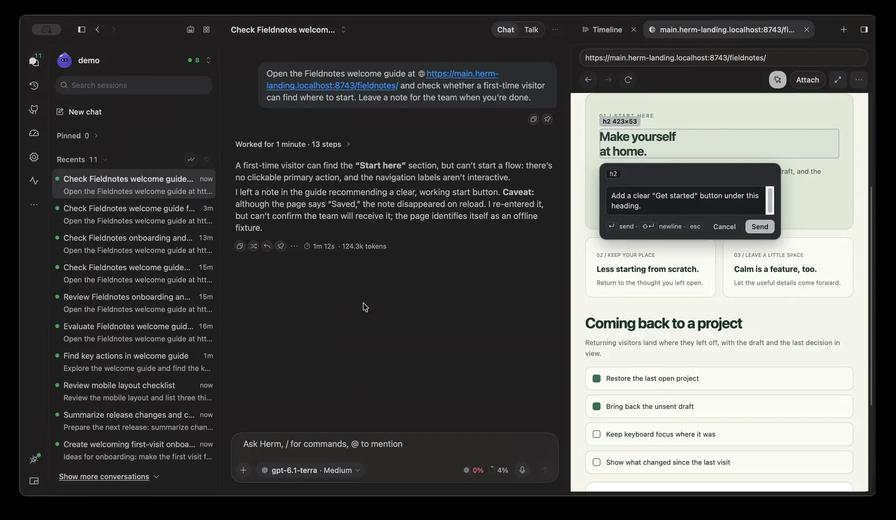](docs/media/browser-demo.mp4)

*▶ [Play the recording](docs/media/browser-demo.mp4)*

Unless noted, screens and recordings in this README show fictional projects and conversations.

> **Ask from anywhere → keep working → notice when needed → respond quickly → inspect the result.**

App labels and default chat identities use **Herm**. **Hermes Agent** names the backend; its commands, API endpoints, and shared configuration keep their Hermes names. `make naming-contract` checks default labels and common client-branding regressions as part of `make guard`.

Herm is a **frontend for Hermes**. Agent execution and session history stay with Hermes. Herm connects to the runtime already installed on your Mac and gives it a native interface alongside the Hermes CLI. It's an unofficial community project, separate from the official Hermes Agent Desktop app ([more](#disclaimer)).

```sh
git clone https://github.com/chryzxc/herm.git
cd herm
swift run
```

---

> [!IMPORTANT]
> **Herm doesn't yet do everything Hermes Agent can.** It includes a subset of Hermes features, and each one only turns on when the installed Hermes version supports it. Hermes Agent moves fast, so Herm will keep adding features over time. If something works in the Hermes CLI but doesn't appear here yet, it probably hasn't been added. See [Current limitations](#current-limitations) for the full list, and feel free to open an issue.

---

## Table of contents

- [Why Herm](#why-herm)
- [The notch](#the-notch)
  - [Quick Message](#quick-message)
- [Features](#features)
  - [Generative UI](#generative-ui) (visual and interactive replies)
  - [Appearance](#appearance)
  - [Conversations](#conversations)
  - [Chat composer](#chat-composer)
  - [Voice mode](#voice-mode-continuous-spoken-conversation)
  - GitHub: [Pull requests](#pull-requests), [Issues](#github-issues), and [Repositories](#github-repositories)
  - [Execution timeline](#execution-timeline)
  - [Developer tools](#developer-tools) and [native review workflows](#native-review-and-workflow-tools)
  - [File previews and revision notes](#file-previews-and-revision-notes)
  - [Agentic browser](#agentic-browser) and [iOS Simulator and Android Emulator](#ios-simulator-and-android-emulator)
  - [Projects and session continuity](#projects-and-session-continuity)
  - [Bots](#bots)
  - [Kanban](#kanban), [Activity](#activity), and [Calendar](#calendar)
  - [Office Preview](#office-preview)
  - [Control center](#control-center) and [Integrations workspace](#integrations-workspace)
  - [Native macOS integration](#native-macos-integration) and [Apple Intelligence](#apple-intelligence)
  - [Automations and quota](#automations-and-quota)
- [Requirements](#requirements)
- [Getting started](#getting-started)
- [How it works](#how-it-works)
- [Privacy](#privacy)
- [Current limitations](#current-limitations)
- [Development](#development)
- [Contributing](#contributing)
- [FAQ](#faq)
- [License](#license)

## Why Herm

Herm is built around a simple idea: **keep your agents within reach without making their workspace your workspace.** Start work, return to your editor or another app, and use the notch to check progress, quota, and requests for your attention. Open the full workspace when the work needs a closer look—not just to watch a conversation scroll.

It is not intended to reproduce every page or feature in Hermes Agent Desktop. Herm selectively brings useful Hermes capabilities into a **SwiftUI and AppKit interface designed for macOS**, with the notch as its everyday entry point.

### What makes the Herm experience different

| Experience | What Herm offers today |
|---|---|
| **Ambient agent awareness** | An edge notch with session activity, Kanban updates, requests for your attention, and finished results you haven't opened. |
| **Quota at a glance** | A notch preview for supported providers' allowance and reset times, without opening a dashboard. |
| **Quick interaction** | Start a new chat or reply to a specific session from the notch without changing the conversation selected in the workspace. |
| **Real-time spoken conversation** | Continuous Voice mode with spoken replies, interruptions and steering, captions, and a native voice stage with live activity. |
| **Inspect and give feedback** | Preview files in-app, annotate selected text, send revision notes back to the originating session, and inspect local Git diffs. |
| **A view of your agent team** | Profile-based bots, real Hermes Kanban boards, a map of agent handoffs, and a 3D Office Preview driven by task status. |
| **Watch the agent use real devices** | An agentic Chromium browser you share with Hermes, with a live cursor, step status, element annotation, and one browser per Hermes profile; plus iOS Simulator and Android Emulator tabs with touch input, UI annotation, screenshots, and app logs that attach to chat. |
| **Review alongside the work** | Repository checks and coverage information, changed-file diffs. These are aids for inspection, not a guarantee that the agent's work is correct. |
| **Act without opening the app** | Approve, deny, or reply from notification banners (optionally behind Touch ID), send selected text from any app via the Services menu, and trigger Ask Herm from Shortcuts. |
| **A native Mac companion** | Global keyboard access, composer autocorrect and dictation, optional on-device Apple Intelligence summaries, system appearance, Reduce Motion support, and an optional Hermes pet that can roam from the notch. |
| **Generative UI** | Replies that render as native tables, charts, forms, plans, findings, graphs, runnable commands, and sandboxed offline HTML apps, with session and global artifact browsing. |

These are highlights of Herm's experience, not a list of features exclusive to Herm. Hermes Agent Desktop shares many underlying capabilities, including voice mode. The distinction is how Herm brings them together around ambient awareness, quick interaction, spoken conversation, and local inspection.

The design priorities are **useful attention rather than constant activity**, **clear status rather than assumed success**, and **keeping quick actions tied to the right session**. Future improvements should strengthen those qualities rather than add features for parity alone.

## The notch

The notch is the main way to use Herm. It sits against the left or right edge of your screen, stays out of the way while nothing is happening, and shows you when Hermes needs attention.
Side-notch previews and expanded side panels keep a visible themed border, including in Liquid Glass.

[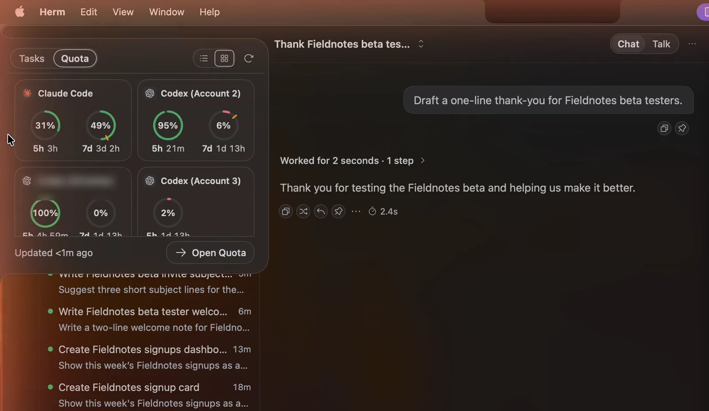](docs/media/notch-side.mp4)

*▶ [Play the recording](docs/media/notch-side.mp4)*

### Hermes companion

Herm displays the selected profile's enabled Hermes pet just below the notch, outside its contour. Its
poses follow task activity: hover over it for a greeting or
click to pet it, without opening the notch. It stays below the expanded preview,
with an occasional celebration after successful work. Hover the notch itself
for status and Quick Message. The pet uses the same assets and selection as Hermes
Desktop and the TUI. All pet surfaces use the same renderer, with Hermes' row
order mapped to native image coordinates so animation does not cycle through
another row's blank padding.

In **Settings → Appearance → Hermes companion**, choose a pet from
the always-visible **Select a pet** gallery, enable or disable it, and adjust its Hermes size.
**Apply to Hermes** confirms the shared change; Hermes handles any download.
After **Apply to Hermes**, the floating pet uses the saved size (100% is the
sprite's native frame size). Its window and roaming bounds resize with it;
the Settings thumbnail remains compact. Oversized pets fit within the display.
Notch announcements, including quota changes, share a centralized pet-reaction
mapping; hovering and petting remain short-lived interactions.
This requires Hermes' `pet.*` gateway methods. Older runtimes keep the ordinary
notch and show companion availability guidance in Settings. Reduced Motion
displays a static sprite.

Enable **Roam from the notch** in the companion settings for walks across
the current display's bottom edge with directional animation, pauses, and periodic
returns home. Task activity and hovering pause movement; drag repositions it.
Right-click the notch or pet and choose **Call pet home** to return it. Roaming
is local to Herm, defaults off, and is disabled by Reduce Motion.

### What the notch shows

The notch changes to reflect what Hermes is doing, so you don't have to keep a terminal open:

| State | What you see |
|---|---|
| **Idle** | A thin, quiet rail on the screen edge. |
| **Working** | A live indicator while Hermes is running a turn, a tool, or a background task. |
| **Needs you** | An attention state when Hermes is waiting for an approval (for example, a dangerous command) or has asked you a clarifying question. |
| **Finished** | A short announcement when a task completes, which stays marked until you open the result. |
| **Offline** | A clear indicator when the local Hermes runtime isn't reachable. |

The Tasks preview opens on **Activity** by default. Its list/grid toggle switches between session activity and **Kanban** cards, using the same controls as Quota. Both views use Herm’s compact status cards. Kanban shows running, blocked, and review cards across boards. Confirmed card moves and edits automatically expand the Kanban preview without changing your selected view; click a card to open its board and inspector. Kanban refreshes every five seconds while the workspace is closed. The initial load stays quiet, and unchanged or failed refreshes do not announce. Up to 30 recent card updates remain until opened; active cards stay visible.

The Activity preview separates **Needs your attention**, **In progress**, and **Finished, not opened**. Approval requests and clarification questions show their own status and a short summary, including requests from other sessions. New requests open the preview; select the row to review and respond in the workspace.

Activity rows in the side notch and top island have no background fill at rest, including the current session. Both previews offer a labelled **Quick message** entry. Reply controls reserve their space so activity titles stay still on hover.

Conversation approvals, clarification choices, and secret/login requests share a compact neutral card with explicit status, labeled inputs, and grouped actions that stack in narrow panes. Multi-select answers show their selected state; submitting keeps an in-place progress indicator and disables duplicate responses.

Choose **Quick message** in either Tasks view to start a new session without opening the workspace. Hover a session row to reveal **Reply** and compose directly beneath it; its reserved slot keeps the title stable. Reply stays visible while composing or navigating with the keyboard, and the reveal respects Reduce Motion. Replies stay tied to that session, and neither action changes the workspace’s selected chat. The compact composer keeps its own draft, preserves workspace attachments, and stays open while typing; **Close** or Escape leaves it. Failed sends keep the text for retry. Kanban rows show the assigned bot’s stored avatar or its existing fallback identity.

Choose a finished session row to peek at its **Latest completed reply** inside the notch. Copy an excerpt, open or reveal generated files, reply to that session, or open it in the workspace. Reading leaves the selected workspace chat alone. A deliberate selection marks the matching completion reviewed after its content loads; hovering does not. New results offer **Update** while the displayed excerpt remains stable.

The notch shortcut opens keyboard interaction: arrows select a session and Return inspects it;
Escape backs out and then dismisses. **More → Saved actions** prepares editable starter or custom
instructions without sending. **Working sets → Checkpoint** saves a note and exact quick-draft
reference for later resumption. **Watch activity** focuses ordinary session activity on one set;
blocking decisions and failures remain visible globally. Result Peek's **Compare with previous
read** compares two deliberately loaded snapshots, including changed output references.

The quick composer accepts dropped files and links, pasted text and images, and an explicitly chosen project for a new session. Its **To** picker captures the profile and session before sending. **Drafts** restores unsent content after a restart; missing or changed files remain visible. Images, one PDF up to 25 MB, and generic files use Hermes' attachment methods when supported. Interrupted or uncertain submissions require reviewing the destination session before resending.

**Settings → Notifications** controls the desktop alert sound and separate alerts for completions,
approvals/questions, session failures, automation results, Kanban updates, quota warnings, watched
pull requests, and watched repositories. New feature alerts are opt-in. Snooze all desktop banners
and sounds for 15, 30, or 60 minutes, or resume early; banner actions also offer a 30-minute snooze.
Snooze includes approvals and failures, keeps in-app attention visible, survives restarts until its
expiry, and does not replay missed banners. Quiet periods below still apply independently.
Use **Send test alert** and **System Settings** to check macOS permission, sound, and Focus settings.

Choose **Quiet** in the Tasks header for 30 minutes, 60 minutes, or until you end it. Completions, ordinary quota changes, and informational updates enter a digest. Approvals, questions, and failures that stop work can still interrupt. The same policy controls notch announcements, pet announcement reactions, and opted-in system notifications. **Review digest** returns to the recorded sources; it stores references rather than response bodies.

Quick approval and clarification answers stay tied to their original request, session, and profile. A pending answer blocks repeated clicks. A confirmed refusal offers **Retry**; an uncertain acknowledgment offers **Check request**, which enables another answer only after Hermes confirms that request is still pending. These answers preserve the workspace draft and attachments.

The status colors match the rest of the app: blue means active, green means healthy or done, amber means a warning or that Hermes needs you, and red means a failure.

Global hover tooltips show one floating, fully opaque, theme-aware panel beside the hovered control and above workspace content and scroll containers. Long help wraps, stays within the display, and never takes keyboard focus.

Chat message timestamps appear on hover, with no separator after the assistant message actions.

### Quick Message

Quick message opens a clean message-only panel with a destination picker and Close.
Tasks, Quota, Quiet, refresh, and Open Herm controls stay out of the way while composing.
It reuses the chat session's growing text editor, themed input surface, attachment
control, and send button. The taller 560pt panel shows your sent messages and live
replies using the session chat's transcript and message actions. Follow-up messages
stay in that conversation; the destination menu starts a new one when you choose it.
The workspace's selected session and draft stay separate. The composer stays at the
bottom; attachments appear inside it.
The + menu offers files, paste, window capture, saved drafts, and discard; review and
retry appear for interrupted sends. Project choices appear only for new sessions.
Inline replies share the same composer and stay tied to the task's session.
Quota advisories are hidden in both composers; send failures remain visible. Return or Command-Return sends;
Shift-Return inserts a newline.

The notch also offers **Recall** for profile-scoped conversation search, **saved working sets**
for explicit destinations, and **session capacity actions** with acknowledged model changes.
Result Peek includes explicitly pinned sources, quoted corrections, Markdown export, and coding
review. Clean turn baselines enable scoped diffs.

Failed or pinned routines open a compact recovery view with execution and delivery shown
separately. Supported Pause, Resume and Run now actions retain the owning profile. Skills & MCP
repair uses Hermes' own installation, credential and OAuth paths. Targeted subagent steering
labels queued corrections honestly; fingerprinted memory entries can be inspected and corrected.
Each operation remains unavailable when its installed-runtime contract cannot be verified.

### How to use it

Session and group-chat lists, project pickers, inspector tabs, approval details,
usage labels, shared inputs, and the chat composer follow the window text scale. Markdown headings
and fenced code resize with reply prose.

Standard UI and conversation font sizes live in `DockTypography`; SwiftUI views
and native Markdown/composer text share these definitions.

Window mode uses standard 100% sizing for fonts, icons, and action
controls: 12pt body text, 13pt navigation labels, and 14pt conversation text. Text renders at its final size, with normal pointer and selection
coordinates on Retina and standard-resolution screens.

| Action | Result |
|---|---|
| **Hover** | Opens a preview with two tabs. |
| **Tasks tab** | Lists every session that's in progress, with the ones that need you first, plus finished results you haven't opened yet. Click one to go straight to it. |
| **Quota tab** | Shows provider usage and reset times, so you know how much allowance is left before starting a long task. A compact **Open Quota** button opens the full quota workspace. |
| **Click** | Expands the notch into the full workspace in the same window. |
| **Double-tap ⌘** | Opens or closes the workspace from anywhere. |
| **Double-tap ⌥** | Opens or closes the hover preview from the keyboard. |
| **⌥ Space** | Quick capture: opens a new message in the notch from any app. Change it to ⌃ Space or turn it off in Settings → General → Keyboard shortcuts. If nothing happens, another app is using the chord. |
| **Drag** | Moves the notch along either screen edge. Its position is saved. |
| **Right-click** | Moves the notch to the left or right edge, or quits the app. |

A typical workflow: start a long task in chat, collapse the workspace, and keep working. When the notch turns amber, hover over it to see which session needs approval, click that session, approve, and collapse again. When the task finishes, the notch tells you.

Choose **Dots**, **Vertical line**, **Ring**, **Icons** (a status icon, with an unread mark for finished replies), or **Count** (the number of working sessions) in **Settings → Appearance → Notch**. The same page switches the notch between a screen **Side** and a **Top island** around the camera. Count is the default. The selection applies immediately and is saved across launches. The vertical line sweeps while work runs; the ring rotates. All notch animations respect **Reduce Motion**.

## Features

Expandable detail sections toggle when you click anywhere in their header row, including the label and empty space beside it.

Async actions show local progress while requests are pending. Markdown PR and issue
links show an “Opening…” indicator while GitHub resolves their inspector tab;
settings, connection, memory, review, and group-chat actions expose pending feedback
and suppress repeat submission. See [the loading-state audit](docs/loading-states.md).

### Generative UI

Generated replies use a macOS-style document surface with a tonal toolbar, visible
Expand action, grouped provenance, inset sections, and rounded metric figures.
The treatment follows your current Herm theme, including Glass and Monochrome.

[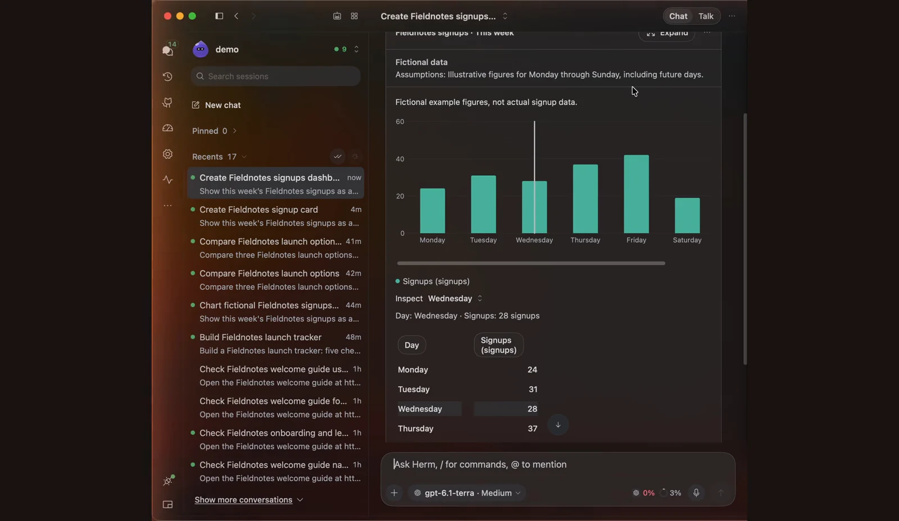](docs/media/genui-demo.mp4)

*▶ [Play the recording](docs/media/genui-demo.mp4)*

Hermes can answer with **visual, interactive replies** instead of plain Markdown: tables you can sort, charts, forms, plans, findings, diagrams, and small offline HTML apps such as calculators, quizzes, and simulations. You don't need special wording. Ask "Create a savings calculator with starting balance, monthly contribution, interest rate, and years" or "Compare these three databases", and Herm asks Hermes for a visual reply when it helps. Simple answers stay Markdown, and explicit requests for plain text, source code, or file changes keep their requested format.

Turn it on or off in **Settings → Chat → Replies → Generative UI** (on by default, applies immediately). When off, Herm stops requesting visual formatting and existing visual replies show their readable text. Rendering instructions travel with your normal messages (workspace, notch, group chats, and voice); they don't change the model or add a model call.

Bot mentions also request visual replies in the recipient's Bot Chat, even while that chat is not open.

**What a reply can contain**

| Kind | Components |
|---|---|
| Data | Sortable, filterable tables with aligned numbers; bar, line, area, and point charts with multiple series linked to a shared dataset (selecting a row highlights it in the chart); metric tiles with comparisons |
| Decisions and plans | Option comparisons against shared criteria, checklists, timelines with dependencies, and workflow steps (proposed, running, passed, failed, blocked, skipped) |
| Structure | Graphs (up to 200 nodes, solid or dashed edges, with status) and collapsible trees |
| Development | Copyable code blocks, review findings with severity, location, and recommendation, and runnable command cards |
| Media and sources | Source link lists, image galleries, and before/after image comparisons |
| Input | Forms with text, number, choice, multiple-choice, and yes/no fields |
| Connected records | Cards that open loaded pull requests and issues, Kanban tasks, Calendar items, usage reports, and the session Timeline in Herm's existing views |
| Interactive HTML | Self-contained HTML apps that use your Herm theme colors |
| Mermaid diagrams | Any ```` ```mermaid ```` block in a reply (flowcharts, sequence, class, state, Gantt, and more) renders as a diagram card with **Preview** / **Code**, **Copy**, and **Expand**. Rendering is offline with the bundled [Mermaid](https://mermaid.js.org) 11.17.2 (MIT); invalid diagrams show the reason and the code |

Sections group related components, and metadata labels **Fictional data**, assumptions, source, and observation date when supplied. Generated status is the assistant's claim: a workflow step marked passed needs supplied evidence and is labelled a reported snapshot, never live state.

**Acting on a reply**

- **Forms** send your answers as a normal message to the original session. They never run actions and must not ask for passwords or approvals. Unsent values survive navigation until Herm quits.
- **Run in Terminal** on a command card opens the session Terminal in the project or worktree directory (or Home), in a fresh shell, so it never overwrites a running terminal. Each command needs its own click; code blocks stay copy-only. See [the command format](docs/generative-ui.md#runnable-command-cards).
- **Use in current chat**, **Ask about selection**, and **Revise…** add the reply as context in the composer without sending or replacing your draft. Revisions of the same reply are grouped, and you can compare a revision with the previous one.
- **Expand**, **View source** / **Copy source**, **Copy readable result**, and **Export…** (`.herm-ui.json`, or a standalone HTML file for HTML apps) live in each reply's menu.

**Safety and limits**

- **Hermes inline widgets.** When the agent writes an HTML file and replies with `::preview{file="…html"}`, Herm shows the widget live in the reply, in the same offline sandbox, sized to its content. Buttons using `hermes.send` or `data-hermes-send` send their prompt as a message in that chat (one per second, 500 characters max). Other files show the usual attachment card.
- **MCP Apps.** An MCP tool that ships its own view (the MCP Apps standard) shows an app card under the turn's activity. Click **Open** to run it in the same offline sandbox; it receives the tool's input and result and can open HTTPS links. Network access a view requests is listed but not granted, and views cannot call tools yet.
- Interactive HTML runs only after you click **Open interactive view**, in an offline sandbox with no network, storage, files, credentials, tools, downloads, popups, or device access. Closing it, switching session or profile, or restarting Herm resets it; changing the theme reloads it.
- A reply is limited to 1 MiB, 100 blocks, and 1,000 rows or points per block. Invalid or oversized replies show **Visual reply unavailable** with their readable text, the reason, and the source. While a reply streams, visual content waits until it finishes.

**Artifacts.** The session inspector's **Artifacts** tab and the global Artifacts library list interactive replies alongside files, images, and links. Outputs appear as transcript pages are indexed; the header shows when indexing is still in progress or incomplete. Saved tools are references to their original reply; inputs, sorting, and selections are restored for the same revision.

See [Generative UI formats and isolation](docs/generative-ui.md) for the `herm-ui` JSON format.

### Appearance

The Herm window's interface scale (its setting is temporarily hidden) is
**Compact** (100%), **Default** (110%), **Large** (120%), or **Larger** (130%). Icons and controls scale
with the text, and the choice is saved across launches.

[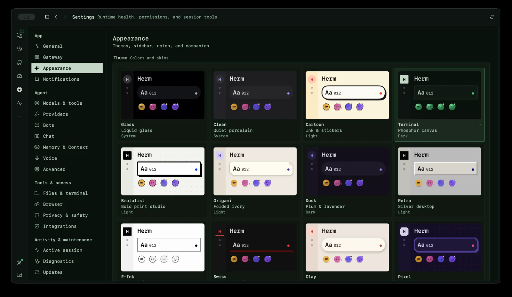](docs/media/skins-demo.mp4)

*▶ [Play the recording](docs/media/skins-demo.mp4)*

Actions use visible buttons, including compact buttons in dense panes. Inline
navigation and Show more links stay underlined before hover, and linked GitHub
metadata carries a navigation arrow so it is distinct from static metadata.
Session Pull Request and Issue warnings keep vertical spacing below the filter divider.

Workspace page headers use consistent text titles and subtitles, with refresh
and other actions on the right. Buttons share 12pt themed labels, hover and
pressed feedback, and disabled states. Shared action icons inherit their label's
skin-specific color, including on filled Glass and neon buttons. Repository Issues
and Pull requests buttons use their matching destination icons. Activity branch
pills use compact metadata sizing. Primary actions use a quiet accent tint;
secondary actions use the shared outlined or compact treatment. The pull request
Merge action uses matching icon and label ink on every skin, including filled
Storm and Glass controls. PR toolbar actions use compact sizing for a tighter row.
Merge uses a shared split button in the toolbar and merge panel: choose an available
merge commit, squash, or rebase method, then confirm the selected action. The dropdown
also opens merge requirements; repository rules and expected-head checks still apply.
Workspace pages, including Settings, use a flat theme canvas without a corner glow. Open Settings from the workspace or with the macOS Settings command (⌘,). Settings opens inside the workspace; Herm does not create a separate native Settings window.
Settings loads the runtime model catalog only when Models & tools opens, keeping General free of those backend requests.

**Settings → Passwords & Logins** manages the same profile-scoped vault as Hermes Agent Desktop.
Choose a profile to view credential metadata, add a website login (with an optional OTP secret), or remove a local entry.
The Password managers section shows backend-reported installation and lock status and supports enable, disable, unlock,
and lock. Manage external entries in their password manager. Passwords travel directly to Hermes through its authenticated
RPC connection and are never saved in Herm preferences or displayed in the credential list. Changes affect future fills,
including active sessions; removing a credential does not sign out existing website sessions. Unsupported or malformed
vault responses disable actions and show recovery guidance. Herm does not implement a separate credential store.

**Settings → Subagents** configures delegation per profile. Choose Default routing or an available model/profile
routing backend, and install the official Advanced Delegation plugin from the catalog when offered. Model routes
support adding, editing, removing, and choosing a default; profile routes show bot avatars and let you choose allowed profiles and a default.
Provider, model, turn limit, parallelism, timeout, and reasoning effort use explicit Apply confirmation and affect future
delegations. Running subagents keep their settings. Routing availability comes from Hermes; unsupported routes stay
disabled, and a blocked saved route is shown honestly. Route edits preserve additional backend options and credentials.
Existing direct-endpoint defaults remain intact and can be edited in Hermes Agent Desktop.

Herm uses one shared workspace design across every custom skin: consistent navigation,
content hierarchy, spacing, and actions. Skins apply their colors, typography,
geometry, materials, and motion on top. Liquid Glass is the default presentation.
See [the design specification](DESIGN.md) and [UI refinement audit](docs/ui-foundation-audit.md).

Shared settings groups and integration icons now follow each skin's material and
geometry. Inspector tabs keep stable widths on hover, with full-title tooltips;
PR and Issues toolbars share consistent insets. Settings controls stack below their labels when needed,
and Bot filters adapt to narrow panes using shared actions. Long composer queues and background
task lists scroll within bounded trays so the message input remains reachable.

The default **Glass** appearance follows macOS Light/Dark with frosted panels
and cool crystal surfaces, with a single native glass background to keep broad
reflections off the chat reading surface. Glass uses fine appearance-aware edges and shadowless controls in both modes;
light mode adds a stronger neutral window backing, darker supporting text, white
frosted controls, and clearer selected tabs so content stays readable over desktop colors.
Popovers and sheets share the skin's opaque canvas, while light Glass cards,
fields, menus, and floating panels use white surfaces without the native warm gray cast.
Filled graphite actions stay distinct from frosted secondary controls. **Clean**
uses airy porcelain surfaces, hairline cards, neutral graphite actions, and stable palette colors for projects, agent activity, and configuration inventories. System-following skins update
automatically when macOS switches between Light and Dark, including while the
workspace is open. Skin changes also apply to the side notch and its open preview.

Herm uses a content-first layout across skins: shared spacing and action sizes, quiet dividers, and cards reserved for distinct objects or tasks. Selected list rows follow the active skin’s selection surface.

Active navigation, icon rails, inspector tabs, and open sidebar toggles keep
visible selection treatments at rest, with filled icons and stronger ink. Liquid Glass
uses a tonal fill without a leading line. Selected
content rows retain a fine contour across translucent and solid skins.
Glass controls have clearer outlines in light and dark appearances.

All skins retain their own visual identity with balanced surface steps, clearer
supporting text, and quieter depth. Paper skins keep warm stock and ink; dark
skins keep their graphite, oxblood, steel, plum, phosphor, and neon hues.
Floating and springy skins lift actions subtly on hover and settle on press;
surface reveals follow each skin’s motion style. Reduce Motion disables these
effects, and Retro, Pixel, and E-Ink remain still.

Choose from the skin gallery in **Settings → Appearance**. Every tile previews
its own typography, material, geometry, and selection treatment. Switching skins
keeps the Appearance page selected while the new skin applies immediately. The gallery
reflows into fewer columns in narrow windows, keeping previews inside their cards. The 21 skins
range from Hermes' desktop look (Nous blue with the etched backdrop from Hermes
desktop) and Ares' oxblood panels to folded
Origami, ruled Notebook, molded Clay, and silver-beveled Retro. Terminal has
phosphor scanlines, Pixel has stepped arcade outlines, HUD has cyan
crosshairs, and Storm has Tokyo Night indigo with rain, matte blue actions, and solid selection markers. Navigation and composers follow the selected skin while keeping
the workspace layout and controls in place. Each skin also moves in its own
way: Hermes snaps like its desktop app, instrument skins move crisply, Cartoon
and Clay spring, and Glass, Dusk, Storm, and Island settle softly. E-Ink,
Pixel, and Retro remain motion-free; other skins respect Reduce Motion.

Herm uses one centralized solid accent palette throughout the app: teal, amber,
violet, coral, blue, orange, pink, green, cyan, indigo, and tangerine. Neutral skins use gray actions and selection;
character skins use their own hue. Live work indicators use the shared blue status tone across sessions, bots, automations, and the overview. Status, charts, agent identities, and file icons reuse the
same approved solid color families. The [color-system audit](docs/color-system.md)
records the mapping for each app area; `make color-contract` guards future features.
Solid fills stay the same in Light/Dark; text ink adapts for readable contrast on each
theme, including Light/Dark, Monochrome, and E-Ink.

The expanded floating workspace fills the panel vertically without extra top or bottom shell padding.

PR lists use green for open work; Issues uses blue status icons with neutral state text.
Ordinary IDs, branches, and drafts keep neutral ink. PR readiness is colored separately from lifecycle.
Category colors distinguish calendar sources, automation, and file changes;
orange is reserved for attention rather than normal draft or modified state.

Shared tabs and Chat/Talk/PR modes carry their selection highlight between choices. Navigation glyphs respond to selection, floating-skin controls lift gently on hover, and retained disclosures ease open and closed while preserving nested inputs.

Shared interface motion includes smoothly updating progress meters and section counts, in-place pending-action spinners, short tab and navigation selection transitions, rotating disclosures, and subtle page/modal content reveals. Effects follow the active skin and respect Reduce Motion; controls remain immediately usable and content keeps its layout footprint.

### Conversations

Saved conversation images are restored from Hermes history when reopening a session, including images stored within message content.
Reopened messages omit Hermes' appended memory recall context and reconcile confirmed sends with saved history.

Recently viewed conversations can show their last loaded messages immediately while
Herm refreshes them from Hermes. The title shows when the conversation is refreshing
or not current; session actions become available after the refresh succeeds. Drafts
remain editable, and the conversation menu offers retry if loading fails.

The session-title popover reuses the sidebar session row, with matching typography,
status marks, timestamps, inline project pills, previews, and session actions.

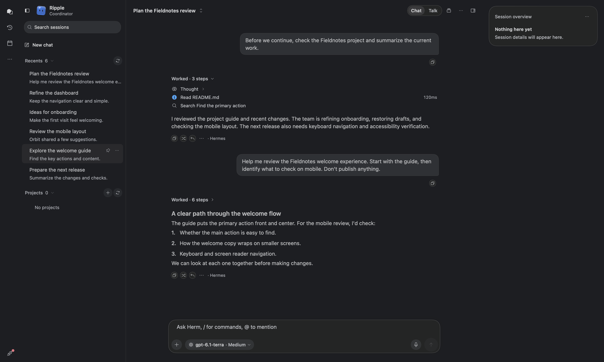

Workspace pages share Calendar’s top titlebar treatment, with sidebar toggles aligned
beside the traffic lights. Chat uses three full-height panes: the session list,
conversation, and inspector. The session title and Chat/Talk controls stay inside
the conversation pane; the inspector's tabs extend to the top of its own pane.
The session sidebar places **New chat** above Pinned. Navigation distinguishes Chats (speech bubbles), Integrations (puzzle piece), and
Artifacts (stacked files), while keeping the Bots ghost icon. Chats shows a small
spinner for running sessions and a count of completed chats with unread updates
for the selected bot. Both appear together when work is running and results await
review; opening a completed chat clears its unread badge. Use **Mark all as read**
beside refresh in the **Recents** header to clear unread updates across the selected
bot’s loaded Recents, including conversations under Show more. Badge calculations are
cached independently of transcript updates; status polling pauses while the
workspace is hidden or Hermes is disconnected.
The sidebar stacks Pinned, Recents, and Projects for the selected
bot under its bot header.
One Hermes request loads recent chats for all bots.
Startup restoration shares the sidebar's session load, so reopening the latest
conversation preserves the complete recent list without a manual refresh.

The header shows compact labelled Chat, Talk, and repository PRs tabs in a quiet 28pt track with full-height click targets. A semibold label and the skin's selection treatment identify the active tab. Opening the inspector in the floating desktop panel keeps the conversation visible beside it. The three panes default to roughly 25% list, 40% conversation, and 35% inspector, with adjustable dividers and minimum readable widths.

The session rail shows beside the transcript and composer by default; use the
stacked-cards **Hide session rail** button beside Conversation actions to hide it. The rail and its toggle hide
when the conversation column is narrower than 800pt, including when opening or resizing
the third panel leaves too little space. Widening the column restores the chosen visibility.
The card is titled **Session overview** when no repository is selected.
Its sections summarize pending questions and approvals, the session task plan,
delegated subagents, workspace checkpoints (with diff and a confirmed restore),
outputs, pinned messages, and the current workspace alongside Changes and PRs.
Tasks share the composer's status indicators and ordering: in-progress tasks first,
pending next, and completed or cancelled tasks last. The active task remains visible
in the Tasks summary and uses a highlighted row and progress indicator when expanded.
Empty sections stay hidden. Expand a section for details; **Respond in chat** reveals
the existing request at the end of chat and focuses the composer, a pinned item jumps to its message, and
**View all outputs** opens Artifacts in the third panel. Output rows use the shared
file-type icons for images, documents, archives, and code. Outputs reuse the shared
artifact index and refresh after a turn or from the rail's refresh action.
Disclosure carets align with the first-row icons, including wrapped titles and task summaries.
Pull requests also collapse as a group, with a count and a bounded list of individual PR quick views.
PR membership comes from explicit links in the selected chat or targeted PR tool operations;
repository listings, searches, and other sessions' history do not add their results.
Live results must belong to the selected response. Switching sessions or profiles resets
rail state and its cached workspace folder; tasks, outputs, attention, and pins use that session's data.
Workspace uses a colored folder icon, a project name and path, and labelled branch
and latest-commit details.
Changes reflects Git status for the session's worktree. Explorer and Source Control follow the folder
confirmed by Hermes, including linked worktrees outside the original project. Chats sharing a worktree
share its local edits. The composer shows the folder and branch row for Git worktrees.
In that menu, find the current worktree above a searchable list;
choose another worktree to open a new chat there and carry over the unsent draft. **New worktree task** creates a new worktree
and moves the draft to a new chat there. Existing terminal shells keep their folders and running commands.
The icon has no background and highlights when the rail is open. Its floating
cards sit over the same continuous conversation background, with the conversation's
scrollbar at the far-right edge beyond the rail. The rail discovers PR
links in loaded conversation messages and targeted PR tool activity, fetches their GitHub details,
and shows PR details inline. Refresh updates details; missing access shows
an unavailable state. The rail uses a quiet repository card with compact PR rows
and a **Changes** row when that session's repository has local edits. The wider card
hides the PR section when no PRs are linked, and shows one empty state when no section
has data. Click Changes to expand the file list, then a file to
open it in a session preview tab. PR rows show quick details in the card. Every
expanded detail area has a 280pt maximum height and scrolls longer content inside
the card; short content keeps its natural height. **View all changes** remains below the file list.
Use **View all changes** to select Source Control, or activate a PR row to open a
separate, closable PR tab in the third panel; the center stays on Chat. Counts show
tracked text additions/deletions against HEAD; new and binary files remain included in the file count. The card's actions menu
refreshes both GitHub and repository data. Hide the rail to give the conversation
its full width.

Session list spinners follow Hermes’ live execution state and refresh every ten seconds while the sidebar is visible, including unopened sessions for the selected bot. Recent writes alone do not indicate running work; the next live refresh clears missed completion events.

The empty chat centers the orb, introductory text, and composer together. Once a message appears, the welcome fades and the composer moves to the bottom. Transitions respect Reduce Motion and motion-free skins.

Every third-panel tab can be closed, including the last one. With no tabs open, launch cards open Browser, Terminal, Explorer, Artifacts, Source Control, or Timeline; the **+** menu and **Command-Shift-T** remain available.

Tab close buttons have full-height click targets. Hover a tab’s icon or name to expand the tab in place, revealing its complete name and close button. Compact tabs return to icons when the pointer leaves. Labels use the available width; only the tabs needed to fit the strip collapse, with the active name kept visible when possible. Switching tabs or resizing reveals the active tab automatically. Drag its name or icon to move the tab while the window stays still; the tab menu also offers Move tab left/right. The + menu stays reachable, and each conversation keeps its order during the current app run.

Inspector tab hover expansion uses a leading-aligned row without width animation. Drag previews carry the whole tab, including its icon, title, background, and close action.

Session workspace tabs share a centralized 16pt horizontal inset. Artifacts avoids
stacked header and filter padding; Browser keeps its toolbar inset while rendered
webpages fill the available tab width, including additional browser tabs.

Discord sessions show a compact tinted pill with the Discord icon beside the preview. Other session sources omit the origin pill.

Markdown GitHub pull request and issue overview links open the shared PR or issue detail view in chat’s Pull Request or Issue inspector tab
when that page is enabled in Settings and GitHub resolves the item. Each chat keeps
its own GitHub selection; opening a link leaves the conversation visible. Disabled pages,
unavailable items, and links to anchors or subpages retain the browser fallback.

- **Streaming chat** with Markdown (including tables with optional outer pipes and table text sized to match reply prose), images, tool output, and inline clarification requests. Response text reflows at the current pane width, keeping its action rail beneath the content when resizing.
- **Image previews** preserve their original proportions without square padding, so wide and tall screenshots fill their intended thumbnail size. Click an image to open the full preview.
- **Website links** show an inline favicon beside their underlined label. GitHub links use a bundled, theme-aware mark; bare PR and issue URLs display as `PR #123` or `Issue #123`. Other public sites load `/favicon.ico` over HTTPS with a globe fallback.
- **Working bot**: a larger, borderless 40pt avatar reacts to activity with reaches, tilts, and hops, including a soft landing and the current activity icon. Rapid updates blend smoothly, and new activity rows appear immediately. Reduce Motion and motion-free themes keep it still.
- **Running activity** keeps duration text free of shimmer while elapsed time continues updating, with a separate live-work sweep that pauses when Herm loses focus and stays still under Reduce Motion or motion-free themes. Running and completed tool durations align at the right end of each chat activity row.
- **Completed activity** starts expanded when the response has no text or images; the activity disclosure can still be toggled.
- **Edit activity** can expand to a selectable, wrapped diff preview that scrolls vertically.
- **Transcript scrolling** follows new output only while you are at the bottom. Scrolling up keeps your reading position through streamed replies, new questions, and transcript refreshes; return to the bottom or choose the floating **Scroll to bottom** arrow above the composer to resume following. The arrow appears whenever you are away from the latest content and shows a count when new messages arrived, with an opaque background that keeps it legible over the transcript. A single travelling rim highlights unread messages or an active response; the down arrow stays still. The control eases into view and animates count changes. Loops stop under Reduce Motion, motion-free skins, or a hidden workspace. Completed assistant replies of every length create nearby text sections as needed while preserving their full height and selected text. History paging reveals eight messages at a time and preserves ongoing scroll movement instead of restoring an earlier offset. Replies with tool activity and hidden entries also continue loading older pages. A session-scoped coordinator owns paging and navigation; unrelated workspace refreshes leave transcript snapshots unchanged. Activity in other sessions and streaming activity outside the mounted history window also leave the visible transcript unchanged; returning to the live reply shows its current activity. Requested history pages prepare during scrolling and stay pending until their measurements are ready; bounded in-memory height measurements survive row remounts. Long streaming replies reuse stable Markdown sections and prepare only changed chunks. Navigator history is reused across activity updates, and ordinary Markdown streaming avoids restarting visual-reply parsing tasks. Find scans full message text off the UI thread, cancels obsolete queries, and reuses matches when Return selects a result. Activity updates reach only the message owning the relevant bot dispatch. During manual scrolling, live replies defer text reflow and show the latest received text when scrolling settles. Jump to latest respects Reduce Motion.
- Adjacent history prepares its text layout in small slices before it appears. The current page stays visible while it prepares; an unusually slow preparation falls back to normal rendering so older messages remain reachable. Timeline updates its row window only when the buffered rows change.
- **Jump to message** sits on the left edge of wide conversations, with hover previews opening to the right. Find opens along the same left edge.
- **Message actions**: completed replies show Copy, Retry, and More, with timing metadata aligned to the right. More contains read aloud, branch, reply, pin/unpin, open in a tab, and forwarding to a bot. Active playback keeps a Stop control visible.
- **Bot replies** expand beneath their activity pill into padded cards with vertical breathing room and fully selectable text.
- **Pinned conversations** use Hermes' own pin, so pins are shared with Hermes Agent Desktop and `hermes sessions pin`. Pin changes appear after acknowledgement; older refreshes cannot undo them. Saved TUI sessions without an HTTP execution owner use Hermes' verified, profile-scoped pin/unpin command.
- **Action errors** appear in a popup with a red background at the bottom-right of the active Herm window or sheet. The close button accepts the first click while the workspace keeps keyboard focus. Session, model, group, Bot visibility, project, task, automation, memory, GitHub, source-control, and login-setting actions report failures with sanitized details. Background refreshes retain their inline unavailable or stale states.
- **Bot and activity previews**: click a known bot mention pill, a bot dispatch pill, or an activity row to open its own closable third-panel tab. Inspect the available bot profile and model, full dispatched task/reply, or tool input, output, arguments, timing, and changes. The preview action stays in the message bubble’s More menu; inline previews use clickable names and rows. Existing tabs are selected and refreshed instead of duplicated; unloaded data is labelled as a captured preview.

- **Message reading tabs**: use a message bubble’s **Open message in new tab** action to keep a completed message visible in a closable third-panel tab while you work. Tabs support Markdown and attachments, stay scoped to their conversation, and last for the current app run. Reopening the same message selects its existing tab. No backend patch is required.

- **Pinned messages**: pin or unpin saved user and assistant messages, then use **… → Pinned messages** to jump to them. Bubble actions refresh their session target when a conversation resumes under a new runtime ID. Accepted pins survive transcript-view replacement and remain scoped to the selected conversation. Pins live in Hermes and survive compression. They bookmark messages for navigation; they do not keep them in model context or protect them from deletion or rewind. Profiles and new branches have independent pin lists. Requires the message-pins backend patch in [docs/message-pins.md](docs/message-pins.md); stock runtimes show an unavailable notice.
  Message pin updates open the pinned list after verification. Errors remain visible across refreshes until another attempt or conversation reset; an unavailable or mismatched reread leaves the saved state uncertain.
- **Dangerous-command approvals**: *Deny*, *Allow once*, or *Always allow*. *Always allow* is saved to the Hermes allowlist.
- **Split session panes**: drag a session from the sidebar into the chat area, or use **Open in Split View**, to work in up to three columns side by side. Each column is a tab group with its own transcript and composer. Click any tab to make it the active session; the header (Chat/Talk and the session menu) moves to its column. Drop onto a column to add a tab, or at the trailing edge to open a new column. Columns last for the current app run.

### Chat views

The chat sidebar has a **Search sessions** field for loaded session titles, previews,
and project names in the selected bot scope. Results include pinned and project
conversations beyond the ten recent rows. Clear the field or press Escape to restore
the normal sections. Search does not scan unloaded transcript history.

Chats has two layouts: **List** (one conversation beside your sessions) and **Tiles**
(every session at once). Switch with the **Tiles** layout menu in the header or
**Chat tiles** under **New chat** in the sidebar. **Settings → Chat → Layout → Default chat
view** chooses which layout the Chats rail button opens. Tiles cover every bot's
loaded recent, pinned, project, and active sessions in one board, with no bot picker;
with several bots each tile shows its bot avatar and name. It is not a complete historical archive.
Opening a tile from another bot switches to that bot.
The **Ready to review** header has a **Mark all as read** button at its trailing edge that clears every tile listed there (respecting the search and project filters).

Tiles are grouped into **Needs you** (approval, question, failure), **In progress**,
**Ready to review**, and **Recent** (collapsed by default), using the same runtime and
unread states as Chats. The status filter shows each group's count; you can also filter
by project or search titles and previews.

Tiles have a compact status and age row, a two-line linked title, project context,
and a readable preview of the most recent saved reply (read from the latest eight
messages without activating the session). Click anywhere on a tile to open its chat.
Working tiles show the current tool and keep a steady order while they run.
Search and project controls sit above the status filters, which scroll at narrow
widths. Reply fields and tile outlines highlight keyboard focus and follow the
selected skin. Cards appear and change status without fading. The header uses consistently
sized compact controls, a layout menu, bot avatars in the picker and its choices,
and New chat at the trailing edge. From a tile you can:

- **Answer requests**: approvals and single-choice questions show their buttons
  (for example *Allow once* / *Deny*) and send through the same path as the notch.
  Multi-question requests ask you to open the chat.
- **Reply** to an idle session without switching chats. Replies to a working session
  are disabled until its turn finishes.
- **Stop** a working turn that Herm's gateway owns. Runs started in another process,
  such as `hermes chat` in a terminal, show progress but cannot be stopped from Herm.
- **New chat** opens the regular composer in a focused modal above the tiles, using the
  selected bot. **Open workspace** moves it into the full conversation workspace.
- **Open** the full conversation by clicking the title. It opens in a sheet with the
  regular composer, attachments, and steering; **Open workspace** opens its full tools.

Activity refreshes with the workspace's ten-second poll; disconnected or failed reads
keep the tiles with a not-current notice.

### Chat composer

Chat keeps unsent text, attachments, context, and reply quotes with each session
while Herm is open. Switch sessions, pages, or bots and return to continue your
draft. Drafts are separate for each bot/profile and are cleared when Herm quits.
Drafts are saved during navigation; typing continues to update only the composer.
Short drafts keep the composer compact; it grows as text wraps.

Background processes listed for the current chat can be stopped after confirmation,
even when the general activity capability probe is unavailable. Process output
continues refreshing after the turn finishes; Stop targets only that session's process.

The **Effort** control uses Hermes' model catalog to offer inputs for the selected
provider and model. Unsupported or unverified availability is shown in place;
open an unverified control to refresh. Session changes are confirmed by a Hermes
readback, while a new-chat choice is a draft override and does not change the
global default. Offered inputs are not a promise of the final provider wire level:
Hermes or the provider may adjust them. When Hermes reports a different route
entry mapping, the control shows both values (for example, Ultra → Max).

The composer’s **@** picker shows each bot’s actual name, with its description when available. Hover or click the context gauge to see usage, the estimated category breakdown, and the runtime’s compaction threshold with remaining tokens in a popover, without a separate hover tooltip. Older runtimes show when the threshold is unavailable.

- **Autocorrect in chat** is on by default. Change it in **Settings → Chat → Typing**. Native macOS spelling correction and continuous spell checking follow the languages available on your Mac; the setting applies immediately without replacing your draft or selection. It works without Apple Intelligence.
- **Live dictation** inserts recognized words and corrections into the draft without sending. Retry or dismiss recognition warnings while keeping the words already captured.
- **Removable context tray** keeps attached PRs, browser pages, files, and conversation excerpts beside the draft. Inspect or remove a chip before sending; attaching context preserves your text.
- **Steering during a turn**: guidance you type while Herm is working is added to the running turn at the next tool boundary.
- **Queued messages**: when the current conversation has queued messages, every subsequent send joins the end of that queue, including plain text during a running turn. New submissions also wait behind a redirect still awaiting Hermes' reply. During a turn, text and attachments queue together. Submitting clears the composer immediately while preserving images, PDFs, context, and reply quotes with the message.
- **Attachments**: files, pasted images, prompt snippets, several images at once, or a single PDF up to 25 MB. PDFs are sent as original files for the agent to read, without requiring `pdftoppm`; sent images show previews and documents show file-type labels. Drop Markdown, text, source, and other files into the composer as removable attachments (up to 8 MB each); uploads require Hermes protected file attachment support. **Files** and **Images** open a native attachment picker; **Folder** opens a directory picker and inserts its path into the draft.
- **Video replies** play inline with native playback, seeking, volume, and fullscreen controls. Playback starts when you press Play and stops when the attachment leaves the view. Open and Download remain available; formats or codecs macOS cannot play show an unavailable message.
- **Model picker** grouped by provider, with search. **Edit available models… → Unselect All** hides every model except the active one; selections are saved locally.
- Confirmed model switches appear inline in chat with the model, provider, and time. Notices come from Hermes session history and return when you reopen the chat.
- **Mixture of Agents**: Settings → Models & tools edits Hermes' MoA presets (reference models, aggregator, enabled). Enabled presets appear in model pickers as `MoA · <preset>`; while a MoA turn runs, advisor output, fan-out progress and the aggregating phase stream into the thinking block. Settings → Models & tools also sets the default thinking level for new sessions.
- **Context guardrails**: the composer shows context progress without a session token total. Its percentage measures the full context window; Hermes can compact earlier based on its configured token limit or other runtime triggers. During compaction, the composer shows **Compacting**, including during streaming turns, and refreshes usage afterward. Context usage is labelled normal, warning (80%), or critical (90%), with actions to branch, compress, or hand off.
- **Capture and reusable context**: attachments include window capture, saved prompts, and selected conversation
  excerpts. Large pastes become text-file context; Command-Shift-V keeps text editable.
  Command-V and the Paste menu accept copied files as compact file chips, even when
  the clipboard also includes a file icon preview.
  Optional app text is configured in **Settings → Privacy & safety → Window capture**.

### Voice mode: continuous spoken conversation

Voice mode is more than a microphone button for dictating a prompt. Speak with your agent, hear its replies, and continue the conversation without typing each turn.
The voice stage keeps worktree details out of the conversation view.

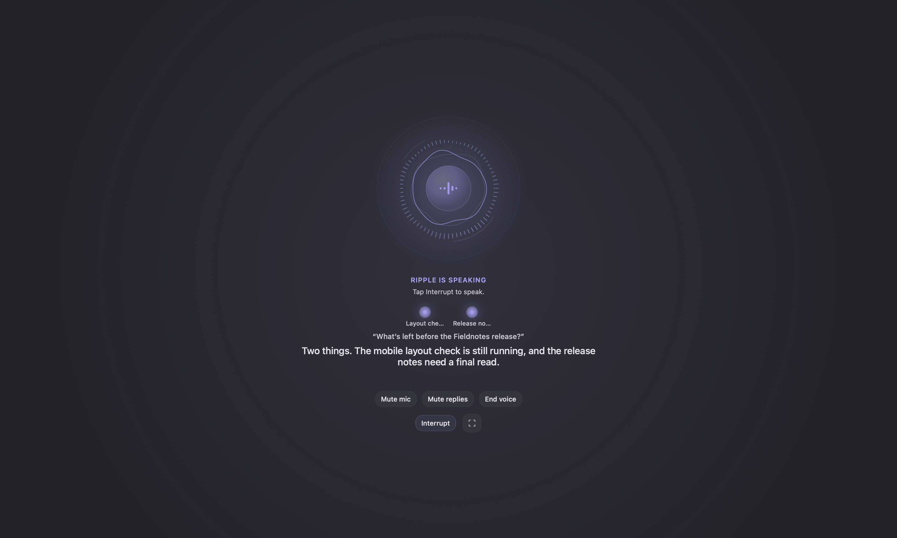

- **Earlier spoken replies:** complete prose sentences begin synthesis while Hermes is still generating. The final response drains only the remaining text; interruption or a session change discards queued speech. Structured output waits for completion so partial markup is not read aloud.
- **Conversation-focused requests:** voice uses a compact spoken-response instruction instead of the visual UI catalog, asks for concise replies, and encourages available background delegation for substantial work. Hermes still owns tools, persona, memory, and approvals; delegation depends on its configured capabilities.
- **Background completion announcements:** active-session task and subagent completions are spoken once, after the current reply or in a quiet microphone gap. They do not replace approval questions or speech already in progress.
- **Voice model controls:** Settings → Voice exposes Hermes’ voice conversation provider, model, and reasoning effort. These affect subsequent spoken turns without replacing the main chat model. A faster configured model or lower reasoning effort can reduce model latency; provider audio latency still applies.
- **Turn model download:** Smart turn detection shows byte-weighted download progress with a single-line percentage beside the progress bar and Cancel action.
- **Continuous conversation** with local speech recognition, voice activity detection, and Hermes-configured speech synthesis. Local recognition starts without waiting for backend recorder checks; Hermes' session recorder is used when local transcription is unavailable. Recognized requests submit after speech stops, including in a noisy room. Ordinary completed phrases use a shorter 0.8-second settling interval (1.2 seconds when the level detector cannot confirm quiet); trailing phrases keep the longer pause. This does not shorten Hermes model or synthesis latency.
- Voice belongs only to the session where you activate it. Switching conversations or leaving Voice mode stops capture and playback, including delayed audio that finishes synthesizing afterward. Spoken requests and reply voices stay with that conversation's Bot profile. Playback returns to listening when its audio finishes; failed requests or playback pause Voice mode and show the error in chat. Microphone startup failures appear on the voice stage with a Retry microphone action. Muting the microphone releases capture, including during replies.
- **Spoken interruption and steering**: speak over a reply to interrupt it, or give additional guidance while Herm is working. The orb also lets you send an utterance immediately, interrupt, or resume listening.
- **A native voice stage** with an audio-reactive orb (Bots wearing a Herm face appear live at its core only when Hermes reports the `hermes-bots` plugin enabled; uploaded or generated avatars keep the plain orb), listening/thinking/speaking states, centered spoken-reply captions, subagent indicators, and labeled microphone, reply, interrupt, and end controls. The conversation stays centered without floating activity cards covering captions or controls. Immersive mode gives the conversation the workspace.
- **Spoken approvals and clarifications** when on-device recognition is available. Requests remain visible, and spoken answers go to the pending request rather than becoming a new prompt. Affirmative answers must be explicit; questions such as “can you run it?” do not authorize execution. Permanent **Always allow** approvals still require the on-screen control.
- Talking over a local spoken reply stops playback and keeps the recognized words for your next request. Reply-echo filtering uses the currently spoken caption. No extra speech package or provider key is required.
- **Follow-up and wake behavior**: with on-device recognition, a 30-second quiet follow-up window can pause into wake-phrase listening. Say `Hey <agent name>` to resume; this applies while Voice mode is active, not as a system-wide wake listener.
- **Separate microphone and spoken-reply controls**, so you can mute input or turn off spoken replies.
- **Playback-aligned captions** show the same short segment sent to speech synthesis when its audio starts. Captions stay centered and wait during synthesis, rather than advancing on a reading-speed timer.
- **Live dictation** updates the composer as words are recognized, including corrections, without sending the draft. Recognition warnings offer Retry and Dismiss, clear on a new capture or session change, and keep any successfully recognized words.
- **Clearly labeled fallback** to macOS speech when Hermes voice support or dependencies are unavailable. The fallback is not a promise of the same continuous experience.

Opening or leaving other pages does not initialize microphone capture. Permission requests stop progressing when voice startup is cancelled. Voice mode requires microphone access; on-device recognition also requires macOS speech-recognition permission. Transcription and speech output depend on the installed Hermes runtime and its configured voice services. “Real-time” here describes the interactive spoken experience, not a claim of a provider-independent, full-duplex speech-to-speech transport.

Hermes Agent Desktop [also documents voice mode](https://hermes-agent.nousresearch.com/docs/user-guide/desktop). Herm's emphasis is its native voice stage and its integration with the rest of the agent workspace, not an exclusive claim to voice support.

### Pull requests

Pull request descriptions display task lists, separators, embedded HTTP(S) Markdown images and GitHub-style image tags, and common inline HTML (such as Dependabot release notes) as formatted text. Links on GitHub pages open in your default browser.

Selected pull request and issue cards use a themed fill and outline. Wide pull request summaries separate the description/activity column from the details sidebar with a themed vertical hairline.

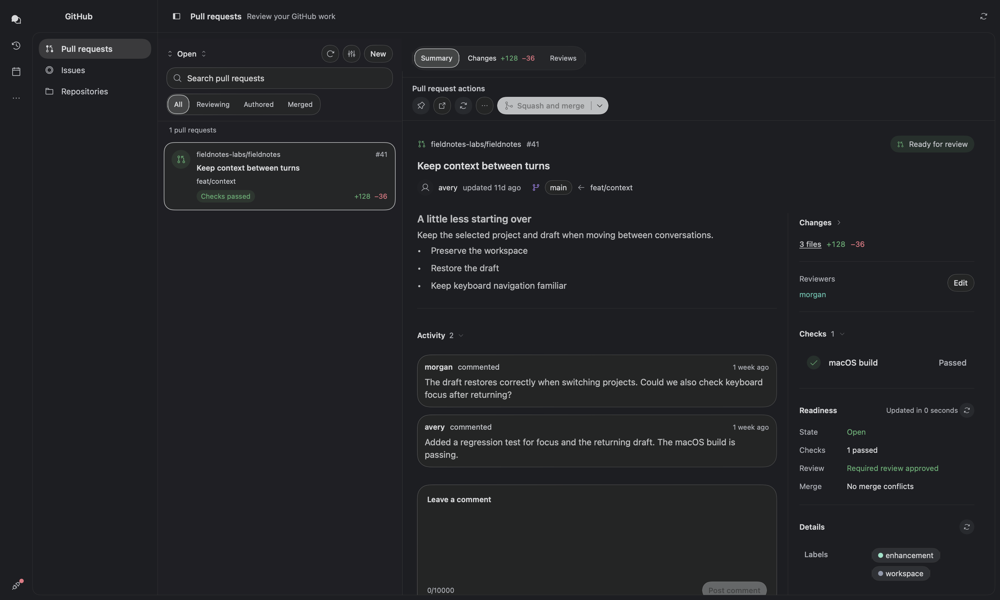

- The pull request detail uses a ChatGPT-inspired open reading layout: Summary, Changes with line totals, and Reviews tabs; description and activity in the main column; and changes, reviewers, checks, readiness, and metadata on the right. Narrow panes stack the columns. The header separates the tabs from a labeled pull request actions row, which wraps in narrow panes. Compact tabs omit line totals, which remain in the summary. Expand Changes for file categories and partial-coverage notices. The Merge dropdown opens protected landing controls from the toolbar.
- On the standalone Pull Requests page, a floating bottom-right **Chat** panel uses the session chat’s composer, message bubbles, activity, and reply actions. Minimized and expanded chat float over the page without reserving a bottom strip. PR content remains visible around the panel in Summary, Changes, and Reviews. Each PR links to its own Hermes session under the default bot profile; reopening the PR, including after restarting Herm, resumes that conversation. PR context accompanies messages, and the selected workspace conversation and attachments stay separate. Minimize the panel or open its linked conversation in the workspace.
- Session **PRs** and **Issues** tabs appear when the session's local working directory belongs to a Git repository or worktree. They use the existing session chat instead of a floating panel. **Attach to chat** adds the PR as a removable context chip without sending, switching sessions, or replacing your draft. Reattaching refreshes the chip. On the standalone Pull Requests page and the repository overview, the **Attach to chat** icon offers a new chat or a recent one.
- Attached context appears once in the composer’s removable chip tray. PRs, browser pages, files, and other context no longer also insert a copy into your message text. Existing inline context moves to the tray without losing its contents.
- Minimized PR chat collapses to a small **Chat · #PR** button, hiding both the conversation and composer. Click it to reopen and focus the composer; drafts and attachments are kept.
- Pull request rows separate repository, title, branch, and status, with a visible selection marker. Lifecycle and readiness colors adapt to the active theme. Summary status controls include state icons, and description text keeps a readable line width.

- PR summaries use a violet branch-route icon and baseline-aligned reviewer and conflict-warning icons. The reviewer picker provides a searchable, aligned checkbox list and reports when no reviewers match. Reviewer and metadata pickers center their initial loading indicators.
- Open pull requests for the session's repository, with check status, review state, blockers, and deep links. The **Merged** filter includes the repository's merged PRs from the last 14 days, including PRs by other contributors; unavailable merged history is reported without hiding open PRs.
- The session header shows Pull Requests only when the session is connected to a project or repository.
- Pull request filters adapt to narrow panes with a compact selection menu; session search stays in the full-width first row, matching the Issues layout.
- Pull request and issue headers provide one GitHub open button; the actions menu keeps editing and Copy link.
- Summary, Changes, and Reviews tabs keep their full clickable area when the detail header shares the window title row.
- Reviews groups thread filters and feedback in clear sections, with an editor prompt, Markdown preview, and character limit.
- Newly opened diff files start at the left edge, with source visible beside the line-number gutter.
- The Changes tab centers its loading indicator and message beneath the fixed pull request header.
- The attachment Diff tab shows working-tree diffs directly under the file header, without a “Working tree changes” heading.
- GitHub Details matches the shared content-section title style used by Description, Checks, and Activity.
- Diff toolbars use a grouped layout switch and compact icon actions, with a visible wrap state and loading spinner for additional context.
- Long lines wrap by default in pull request reviews and the repository code editor, matching shared diff views. Wrap controls remain available, and saved preferences are respected.
- Every expanded page (Timeline, file diffs, local and observed reviews, pull request code review) shares one header that stays clear of the window controls, with Close and Esc to return. The pull request inspector’s Changes tab has an Expand button for full-window review.
- Expanded reviews show explicit Unified/Split choices, and use the full width for added or deleted files.
- Review-option menus align labels to the left and show checked or unchecked boxes on the right.
- The Code toolbar uses an ellipsis menu for review actions, including watching a pull request and generating a review guide.
- The Pull requests page loads its list first, then fetches branch, check, and review details as rows come into view.
- Create draft pull requests and edit a pull request's title or body, with a confirmation step.
- Shared metadata uses wrapping pills for assigned labels, assignees, milestones, and Development links. Labels, Milestone, assignees, and Development editors prepare changes locally and confirm before saving.
- Readiness keeps state, check, review, and merge facts in the summary side column. The Merge toolbar dropdown opens requirements and landing controls; narrow panes stack the sections. Freshness stays in the header and conflict-recovery actions wrap below the facts. It keeps checks, reviews, drafts, and conflicts separate. PR status and metadata pills use regular-weight text consistently. Network actions show compact pending feedback, prevent duplicate submissions, and apply confirmed lifecycle changes immediately. Merge actions refresh stale already-merged pull requests without submitting another merge. Successful merges update shared PR state from GitHub’s confirmed response and offer confirmed remote branch cleanup without changing local branches. **Analyze conflict files** appears only for open PRs with confirmed conflicts and known revisions, and uses an isolated temporary repository; **Prepare resolution in Hermes** fills chat context without submitting it.
- Activity and discussion entries show the author’s GitHub avatar when available.
- Pull request Activity shows a clickable short commit hash. Select it to review that commit’s changed files and diffs in Herm.
- Commit identifiers use a shared code style. Check status appears only for verified current checks on the exact repository and revision; incomplete or unavailable results are never presented as a pass.
- Discussion, review bodies, inline threads, replies, thread resolution, approval, and request-changes use the common Markdown renderer. Changed lines have line numbers and a context-menu comment action.
- GitHub recovery links in readiness and landing use compact themed buttons with an external-link icon.
- GitHub detail metadata uses compact label/value rows, with wrapping pills and section-specific recovery actions. Merge method and landing actions share a wrapping control row.
- Landing controls show merge blockers inline, including missing reviews, failing/pending checks, conflicts, permissions, and branch updates. They use repository-supported methods, current permissions, confirmation, and expected-head protection. Auto-merge and queue requests display waiting/queued states separately from merged.
- **Not supported:** force-pushing, dispatching workflows, or a native conflict editor.

PR Summary sections share a padded leading edge for headings and content, with stronger section titles.

Open pull requests offer Edit beside Reviewers to select people with repository write access.
Changes require confirmation, preserve team requests, and refresh from GitHub.

Merge stays disabled for draft pull requests and unmet GitHub merge requirements.
Hover over the main button for the blocker; the dropdown retains View merge
requirements for refresh, queue, and auto-merge actions.

### GitHub issues

The **GitHub** destination opens a navigation panel with **Pull requests**
and **Issues**, with the selected page beside it. GitHub reopens the last section
used during the current app session. Narrow windows use a section picker instead
of the extra panel. Settings can hide either section; hiding both hides GitHub.

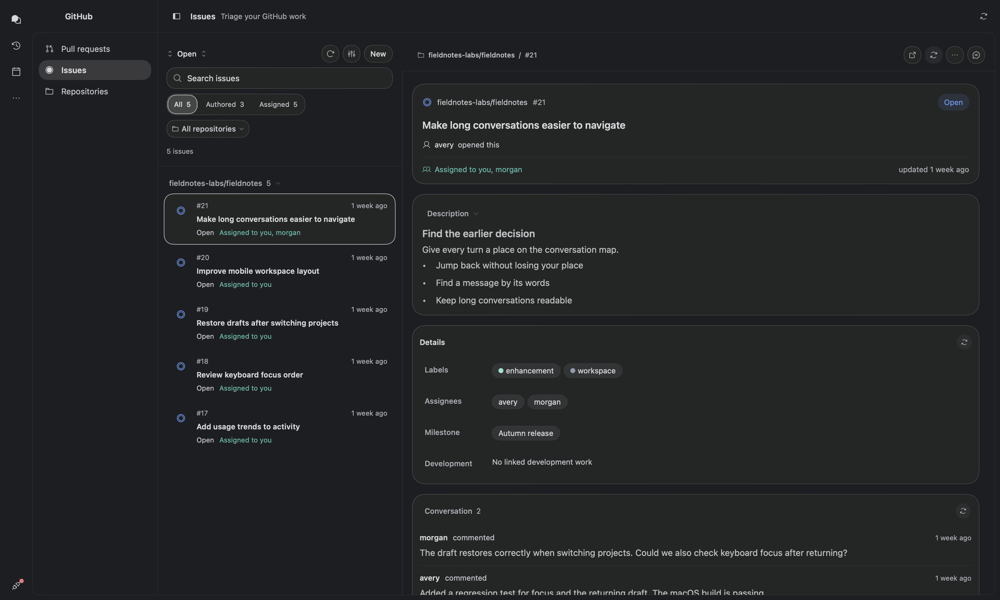

- PR and Issues headers share compact action spacing and keep window dragging clear of controls. The Issues repository filter uses the themed menu.
- Header icon actions share a 28pt footprint; section refresh/edit actions use 24pt with no extra button-style padding.
- PRs and Issues use compact New, refresh, recovery, landing, and inline discussion actions.
- Switching Open, Closed, or History shows an in-place loading spinner; Issues shows loading rows while a new scope loads, retaining prior results if it fails.
- PRs and Issues share a compact view-options menu with checked sort choices and separate save/restore actions.
- The **Issues** page includes your authored and assigned issues, plus open issues in your GitHub repositories and local projects, including reports from others. Forks and their original repositories are excluded; incomplete results are reported. Repository scopes, open/closed/history views, metadata filters, sorting, and saved presentation preferences are also available.
- Create or edit issues, manage assignment and metadata, comment, close as completed/not planned, and reopen with confirmation. Descriptions, comments, and editor previews use the same native Markdown pipeline as chat.
- Development links navigate between Issues and Pull requests. Descriptions and selected discussion entries can be attached to Hermes chats.
- Lists and selected details load when the page opens and refresh only from the refresh button, so reading code or a description is never interrupted. Last successful content and per-item comment drafts are retained.

Issues uses the same themed overview and selection markers as Pull requests.
Open issues use blue, closed issues violet, and assignments teal. List status icons
are unfilled, with neutral state text; the detail header keeps one tinted state badge. Description
comes before Details, with readable line lengths and a collapsible section.
Conversation events share one divided group, and the comment editor includes
Write/Preview tabs, an empty-preview message, a visible prompt, and a separate
submit row. Repository filters wrap below issue tabs in narrow lists.

See [GitHub workspace behavior and validation](docs/github-workspace.md) and the [pull request page audit](docs/pull-request-page-audit.md).

### GitHub repositories

GitHub includes a Repositories tab listing repositories accessible to the existing
GitHub credential, ordered by GitHub’s last-updated timestamp, newest first, with undated entries last.
List timestamps show that same update time; the detail pane separately shows the last push. Search matches names and descriptions;
visibility and archived filters operate on the loaded inventory. Repository browsing
uses the same single page header and resizable list/detail layout as Issues and Pull
requests. On wide windows, a compact list opens a spacious native detail pane; narrow
windows use the shared Back navigation. Details include description, language,
visibility, stars, forks, combined open issue/PR count, default branch, last push, and
license. The overview uses the loaded inventory and supports refresh; missing values
remain unavailable. Open on GitHub is a separate action, and Copy clone URL copies the
HTTPS address without cloning. The tab uses the shared access-recovery panel, reports
partial coverage, and retains data on refresh failure. Filters survive switching between
GitHub sections.

Repository browsing explicitly includes owner, collaborator, and organization-member
affiliations available to the active GitHub credential. The owner filter includes all
returned accounts and organizations; search and archive filters apply across them. Rows
use shared typography, compact descriptions, and the standard divider-led selection
treatment. Repository glyphs, visibility, and star metadata use neutral theme ink.
Language names use neutral pills with the existing bundled file icons; unknown languages
use a generic file icon, and Monochrome/E-Ink render the glyphs in neutral ink. Search,
visibility tabs, and a fixed status slot match the GitHub list controls.
Repository names retain the full row width, with a navigation chevron; update times
sit beside language and stars below descriptions that wrap to two lines. Search
includes a clear action, and empty unpinned sections are omitted. Details use
shared section headers and inspector groups; actions share compact sizing, and the
standard copy control confirms temporarily. The repository detail pane also loads the
five most recent commits on the default branch and the first release returned by GitHub,
including its tag, publication date, and draft or pre-release state. Commit links, SHA
copying, release notes, and an explicit external Actions link support deeper inspection.
Issues and Pull requests open the existing native browsers scoped to the selected
repository, with open state and recently updated sorting. Previous list filters and rows
reset on entry; cached details and comment drafts remain available. Search,
state/history, conversations, reviews, authoring, and recovery use the existing
features. The inventory supplies your highest reported repository permission and last-
updated time; absent permissions remain unavailable. Commit and release reads share the
existing GitHub credential, load independently, retain prior data with a stale note on
refresh failure, and cancel when the detail pane closes or changes repository. The
detail toolbar refreshes these reads and a recent activity feed. The feed shows up to
ten events returned by GitHub, ordered newest first, with actor, action, target, time,
and safe links to the relevant repository page. It includes pushes, issue and PR
updates/comments/reviews, releases, branch/tag changes, and other reported events.
Counts are labeled Statistics; recent issue, comment, and release events remain in
Overview. GitHub can delay events and limits the available history; an empty response
does not imply the repository has never been active. Activity has independent
unavailable, retry, and stale-data states and cancels with the selected repository. A
separate Activity tab follows GitHub’s repository code activity view: compact commit-
message rows, actor avatars, branch links, revision ranges, and semantic merge/force-
push badges. Branch, activity type, user, time-period, and oldest/newest filters query
GitHub’s repository activity endpoint. Branch/user menus list values discovered in
loaded activity. Up to 30 matching records are shown per query, with an explicit
coverage note at the limit. Visible rows load commit messages and comparison counts
using shared, bounded requests; missing counts are never invented, and immutable details
are retained if a refresh fails. Row menus open changes, copy links or SHAs, and retry
failed commit details. Switching filters cancels old work and clears rows from the
previous scope; leaving the pane cancels pending reads.

Repository browsing uses a compact filter toolbar and one detail tab bar. Overview uses an unboxed identity, compact statistics, and divider-separated repository details, release, commits, and events. Activity uses an avatar-led, divider-separated feed aligned to the overview’s reading width. Shared theme typography, language pills, native navigation, copy actions, and Activity filters remain consistent across widths.

GitHub Issues, Pull requests, and Repositories share `GitHubAccessRecoveryView`: a
compact permission panel with a selectable CLI command, Copy command, and pending
Retry feedback. Typed sign-in and permission errors show this panel when no cached
records exist; ordinary outages and rate limits retain their existing error UI.

### Execution timeline

The session inspector’s **Timeline** tab replaces the former Activity Overview/History
with a live execution waterfall. It opens on **All activity**, which stacks every loaded
request with idle time between them collapsed; the menu narrows it to one request or
follows the current turn. A metrics strip shows duration, model calls, tool calls,
delegates, reported tokens, and errors. Duration stops when work is no longer running,
including queued delegates or Bots waiting for input. Unfinished tools use a recorded
stop boundary or keep their duration unavailable. Steps use the chat’s activity icons
and a color per tool type; the slowest step is badged. Activity and Steps sit in separate cards with 14pt headings and collapse independently, and the
Steps header holds the step controls. The time ruler uses readable durations such as
`2 mins 43 secs`, with spacing for the full labels. Search (⌘F) preserves the step
hierarchy; Fit and Live help navigate longer runs. Live is on by default and keeps
the last row of the waterfall and the playhead in view; scrolling the timeline turns it off.
Offscreen steps show a directional timing button; selecting a step pauses Live and
reveals its bar. Fit returns to the start and shows the full time range.
In the inspector the step list is capped in height with the selected step's details
below it; Expand opens the full timeline over the workspace (Close or Esc returns). Finished requests can be
replayed at 0.5–4× with a playhead. Select a step for a card with timing metrics and
its input, result, and diff rendered with the chat’s Markdown renderer. Restored
history takes timing from Hermes message timestamps; restored tool steps are placed at
the time Hermes recorded their result and labelled Finished, since Hermes keeps no start time; local receipt is labelled
observed, and missing timing stays unavailable. Model calls are derived from gaps
between tool batches and labelled as such; the final reply’s model call and cost
are not reported. Delegated subagents appear as their own rows, named by their task when Hermes
gives no name, live bars, nested tool calls, and a link to their conversation. The **Activity** card shows who worked when: one lane for Herm, one per bot profile, and one per subagent, on the whole selection's time axis. Each lane draws its recorded spans with tool and model calls marked inside in their step colors, and failures in red, so order, parallel work and idle gaps read at a glance. Bots come from the same explicit attribution lookup as chat; transcript-only appearances say Timing unavailable rather than inventing a span. A box marks the range the Steps plot shows; click or drag in the chart to move it, click a span to inspect that bot or subagent, and click a lane name to show only its steps (the Steps header shows the filter with a button to clear it). Activity follows Timeline's replay playhead.

Saved Activity and Trace tabs reopen as Timeline. Long timelines prepare nearby labels and bars instead of every loaded step; live activity reuses completed history, and hidden timelines stop their update work.

Timeline uses a single horizontal gutter and compact 36pt bot faces, and shows bot context only after selection. Summary metrics and Steps controls wrap at narrow widths. Steps offers search, Follow and Fit time actions, and Next error navigation that wraps through failed steps. Replay is labeled, and bot/subagent sections remain separate.

### Developer tools

- **Task plan above the composer**: a compact progress ring and count expand into readable steps, with an emphasized current step and completion marks. The current step spins while the turn is working, including after reopening the task details. Progress, step changes, and disclosure animate briefly; Reduce Motion and motion-free themes keep them still.
- **Explorer**: a repository browser with blame information. Project chats use their assigned folder immediately, even before the project list refreshes.
- **Source Control** stays available in the inspector and its + menu while Git state loads or refreshes.
- **Source Control / Changes**: compact Staged Changes and Changes lists with icon-led section titles and a 12pt left inset for section contents (including Graph), hover-revealed per-file stage/unstage toggles, group stage/unstage actions, VS Code–style right-click menus (Open Changes, Open File, Stage/Unstage, Discard Changes with confirmation — untracked files go to the Trash, staged content is kept — Add to .gitignore, Copy Path, Reveal in Finder; group headers offer Stage/Unstage/Discard All), read-only diffs, and a commit message field (⌘Return commits staged changes only). A collapsible **Stash** section saves staged and working-tree changes with an optional message and untracked files, previews saved diffs, and offers Apply, Pop, and confirmed Delete. Apply and Pop restore staged state; failed restoration keeps the stash. Stashes are shared across repository worktrees. A collapsible **Graph** section draws the latest 50 commits of the branch and its upstream as colored lanes with branch, remote, and tag pills; expanding a commit shows its full message, author email, parents, and changed files with line counts, plus Copy hash and Open on GitHub. Expanded cards group author and date metadata, pair a short hash with Copy hash (which copies the full hash), and separate the file summary; empty commits show “No files changed.” Graph header actions fetch all remotes, pull (fast-forward only), and push to the upstream; Git credential prompts fail fast instead of hanging. Local review also checks added lines for conflict markers, likely credentials, and debug statements; credential values are never shown.
- **iOS Simulator / Android Emulator**: live device tabs Hermes can launch and you can drive. See [iOS Simulator and Android Emulator](#ios-simulator-and-android-emulator).
- **Terminal**: a native terminal in the session's project folder, with history, Tab completion, and optional repository checks.
- **Repository review**: reviews the whole repository locally and tells you what it didn't cover. Optional repository watching never starts Hermes work on its own.
- **⌘K command palette** for app actions and Inbox filters.

### Native review and workflow tools

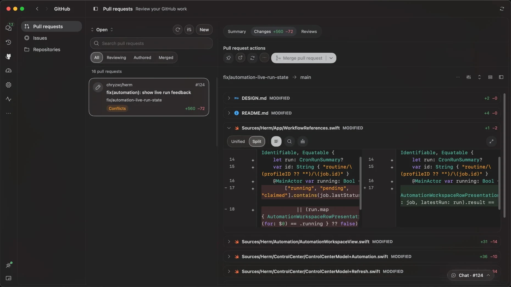

Source control alongside a real Herm conversation:

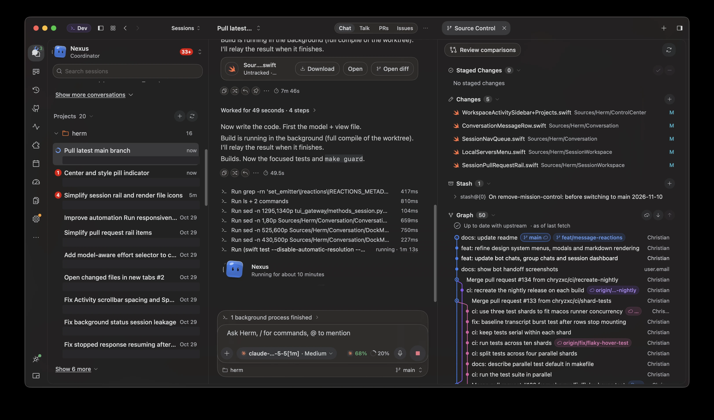

- Source Control uses matching outlined **Review comparisons** and **Actions** controls with leading icons and a dropdown chevron for Actions. Section icons and count badges use a consistent neutral tint; file statuses and graph lanes retain their semantic colors.
- Source Control's **Review comparisons** opens staged, working-tree, branch, and
  commit comparisons from local Git, without fetching. Search covers loaded files;
  incomplete coverage and changed sources remain visible.
- Shared native diffs support syntax colors, split/unified layouts, wrapping, Find,
  expanded review, private line-range revision notes, and validated local context expansion.
- Revision notes stage context in the source conversation. Use **+** beside a PR
  diff line to compose an inline review in the file, including expanded file views.
  Line comments stay private and can be edited beside the file or in **Reviews**;
  **Submit review** publishes them together with the summary after confirmation.
  The Reviews panel explains unavailable submission actions and links directly to Code.
- Highlight diff lines to open a revision-note popover beside the code. Annotated
  lines stay tinted; click one to edit or delete its note. A note icon with a count
  badge appears in the review toolbar once notes exist; open it to **Send to chat**.
  The tray keeps **Send revision** in its header and explains when an owning
  conversation is required.
- **Generate review guide** requests analysis in a separate Hermes conversation. It
  preserves the original task and draft and does not claim an execution sandbox.
  **Generate review guide** is the single AI-review entry point; the PR toolbar
  keeps **Attach to chat** for general questions inside session tabs. PR **More**
  offers **Generate review guide**; a current guide exposes **Read review guide**
  beside Reviews. The tooltip identifies Hermes Agent's bundled `github` skill.
  The request asks Hermes to load that skill's code-review workflow, report if
  unavailable, and keep findings private without changing files or posting to GitHub.
  Choose a reviewer when Bots is enabled, or use the default bot. The guide opens
  immediately, shows a waiting state, and refreshes saved replies automatically
  while open. Open its conversation to follow tool activity or answer the reviewer.
- Terminals survive inspector and session navigation, support splits, and attach
  selected output to chat. Closing the app or a Terminal tab ends its shells (Herm
  asks first if a command is running); reopening starts fresh ones. Closing the
  Browser tab unloads its page until you reopen it; the profile's agent browser keeps running.
- Source Control provides Git changes, commits, stash, and review comparisons without a project Actions menu.
- **Previews** finds loopback
  servers in Herm's terminal process trees. Its themed panel lists process names and
  addresses, supports Refresh, and labels stale results. Nothing runs or opens automatically.
- PR watching is opt-in and passive while Herm runs. It never starts agent work.

Review actions group pull-request watching and guide actions in a compact menu. Raw submission diagnostics stay in the guide; startup shows a loading indicator. New review sessions wait briefly for project-directory confirmation, and active first turns wait for saved history.

### File previews and revision notes

- Chat file rows keep the filename and status on the left, with Download, Open, and available Open diff actions on the right. **Open** shows Markdown (such as plans), text, and images in a session tab beside Timeline and Terminal; other files open in their default app. The tab is a plain preview until you turn on the labeled **Annotate** switch beside **Copy** in its header (or beside **Open in** for files): then selected text takes notes that go back to the chat as one revision request. The annotation footer accommodates larger interface scales. Turning the switch off leaves annotation mode while keeping saved notes; the header controls keep their size as modes change. A file with unsent notes reopens with Annotate on. Messages opened with **Open message in new tab** use the same annotator: Annotate swaps the rich rendering for selectable text, and notes go back to the chat quoting that message. **Open in** opens the file in any app macOS registers for it, or reveals it in Finder.
- Preview **Markdown, text/code, and images** inside Herm. Unsupported file types open in their default app.
- Select text in a document to add a quoted review note, or add a general note. Notes are saved locally and remain highlighted in the preview.
- Send draft notes as one **revision request to the session the preview came from**, rather than manually copying excerpts into a different conversation.
- Inspect changes against the file contents saved when notes were sent. A removed quote can be marked addressed; that is a matching heuristic, not proof that the requested revision is correct.
- Use **Open diff** on chat file attachments with local Git changes to open a dedicated **Diff** tab in the third panel. It shows current staged and working-tree changes separately, or the added contents of a new file, from the attachment's own worktree. **Open** remains available for the file itself. These are current Git changes, which may include edits beyond the AI response. Source Control keeps its inline file previews. Both use the shared diff viewer, which wraps long lines by default without horizontal scrolling.

### Agentic browser

The session inspector's **Browser** tab is a real Chromium browser that you and Hermes share, so you can watch it work.

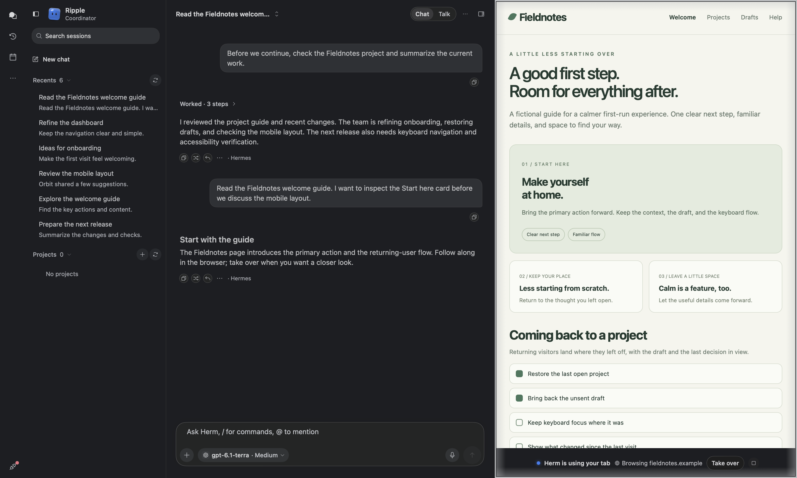

- **Attach browser context.** Click **Attach Page** in the browser toolbar to add the page title, URL, shared Chromium tab ID, and selected text to the session composer. Review or remove the context chip, then type and send your request in chat. Attaching never sends a message or replaces your draft; reattaching the same page refreshes its context. This is a snapshot, so attach again after navigating.
- **Hermes browses here.** Herm starts a background Chrome (or Brave, Edge or Chromium) and connects Hermes' browser tools to it. When Hermes uses the browser, the inspector opens on the Browser tab, the page gets an accent frame, a status pill shows its current step, and a "Herm" cursor shows where it moves, clicks and types. Its last observed position stays visible between steps and when reopening the pane; taking over, using the page, or navigating clears it.
- **Embedded pages.** The cursor also follows observed pointer and focus events in supported embedded frames, including cross-origin frames. Page changes made without a pointer or focus event show browser activity without a fabricated cursor position. When a frame cannot be mapped, its cursor events are omitted while browsing continues.
- **Hermes can show inspector tabs.** Hermes' `focus_pane` (files, terminal, review) and the `herm_inspector` tool from the `herm` plugin (`Sources/Herm/Resources/HermesPlugins/herm`) expand the inspector to the requested tab in that chat.
- **Use Herm's browser** (Settings → Browser, on by default) opens pages Hermes shows (`desktop_preview`) in the Browser tab and blocks terminal `open <url>` or `open -a <browser>`, so "open the page" lands in Herm. Off, those pages open in your default browser; Hermes' browser tools still use Herm's browser.
- **Take over and hand back.** **Take over** pauses Herm so you can handle a login or captcha yourself. **Hand back to Herm** then tells it to continue from that page. While Herm is working, your clicks and typing are ignored so they can't interfere with it. While Herm is in control, an accent glow slowly swells and ebbs around the page edge and a "Herm is using your tab" pill floats at the bottom. Each Herm click sends a wave out from its cursor that briefly lights the page edge.
- **Page dialogs** (alerts, confirmations, prompts, "Leave this page?") appear as a card in the panel, so a page can't stay frozen waiting for an answer. If Hermes answers a dialog itself, the card closes.
- **Annotate** (cursor icon): click any element, describe the change, and Herm sends the element's selector, styles, HTML and a screenshot to the chat. The popup uses your Herm theme.
- **One browser per profile.** Each Hermes profile (and bot profile) runs one agent Chrome, matching Hermes' profile-wide browser connection. Its sessions share it and its sign-ins; each session returns to the tab it last showed, and switching sessions doesn't reconnect Hermes. Switching sessions or closing the inspector keeps live pages and form state without reloading. The browser quits once no session of that profile remains open.
- **Sign-ins stay within a profile.** Sessions of one Hermes profile share its browser and remembered sign-ins. Other profiles, including bots, keep separate sign-ins. Chromium and regular WebKit tabs retain their existing profile stores; opening an extra tab copies only that profile's sign-in for the destination site, and changes carry back to that profile's agent browser. Herm no longer exports shared cookies or requests a browser encryption key from Keychain, including in ad-hoc builds. Existing browser profiles keep their sign-ins after upgrading; the old encrypted shared-cookie file is ignored. More → **Sign Out of All Sites** clears running browser stores and saves a nonsecret reset identifier so closed Chromium profiles clear their cookies before their next handoff to Hermes. A failed reset reports an error and can be retried. Explicit sign-out also removes the obsolete shared-cookie file without unlocking its Keychain key.
- **Typing and forms.** Dropdowns open as a native menu, the pointer changes over links and text, ⌘C, ⌘X, ⌘V, ⌘A, ⌘Z and ⌘⇧Z work in fields, and accents and input methods (⌥E E → é, Japanese, Chinese) compose in place.
- **Downloads and permissions.** Files the agent browser downloads go to `~/Downloads/Herm`. Pages are refused location, notifications, camera, microphone, clipboard reading and similar permissions without a prompt.
- **Links in chat** open their exact destination in that session's Browser, including while the browser is starting. A different URL opens an additional tab without replacing the current page; clicking an already-open exact URL selects its tab. Loaded browser tabs show the webpage name; untitled pages keep the Browser label rather than displaying the URL.
- **Sharp page rendering.** The shared browser renders at Retina density and streams lossless frames so small text stays clear. Frames decode off the UI thread and do not refresh the toolbar or surrounding workspace. Auto keeps one CSS pixel per point; fixed device previews scale down when the pane is narrower.
- **Navigation feedback.** A spinner and slim loading track appear while pages load; Reload becomes Stop. Failed navigation offers Retry without shifting the page. Back and Forward reflect the active page’s history.
- **Responsive browser controls.** The toolbar keeps navigation and the address on one row when space permits; phone-width panels give the address its own full-width row. **Auto** follows the panel’s live width without reloading the page. Phone, Tablet, and Desktop keep a fixed preview width. Annotate and Attach Page stay in the toolbar at every width, without duplicate entries in More; Local Previews is removed from Browser. Use ⌘L for the address and ⌘R to reload. Local addresses such as `localhost:5173` open directly; the actions menu includes Copy Address and Open in Default Browser.
- **Offline notice.** If the agent browser can't start or keeps closing, a notice says Herm can't browse, and the tab falls back to a regular web view. Browser notices overlay the page below the toolbar so failures do not shift the page layout. Use **Retry**, reopen the tab, or reconnect Hermes to try again.
- **Remote backends.** Hermes is pointed at the agent browser only in Local mode; with a remote backend its loopback address would reach the remote host instead.
- **Dev servers over SSH.** In SSH mode, opening `http://localhost:<port>` (or `127.0.0.1`, `[::1]`, `*.localhost`) forwards that port from the SSH host with `ssh -L`, then loads the page. Ports 1024 and up are forwarded; tunnels last until Herm quits. If this Mac already uses the port, the tab says so instead of showing the Mac's server.
- **Sharing the browser with other tools.** Each session's agent browser listens for remote debugging on `127.0.0.1:9333`, or on a random port if 9333 is busy. Hermes follows the selected session's endpoint. A Chrome DevTools MCP configured with `--browserUrl=http://127.0.0.1:9333` stays attached to the session that acquired that port.

### iOS Simulator and Android Emulator

Simulator and Emulator tabs show a virtual device's screen live in the session inspector, so you can watch Hermes run your app and step in yourself. Herm streams device pixels and sends input directly; it never mirrors the Simulator.app or emulator window and needs no Screen Recording or Accessibility permission.

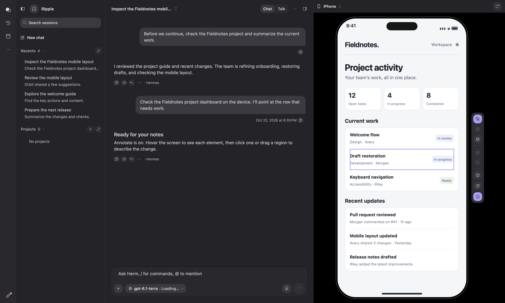

- **Hermes launches the device.** Ask "Run this app on the iPhone simulator" or "Open the Android emulator for this project". With the [Herm simulator tool](Sources/Herm/Resources/HermesPlugins/herm-simulator/README.md) installed, Hermes picks the right device, booting one if none is running, and the matching tab opens in that session. A banner at the top of the chat shows when the session's device is connected, with **Open tab**. iOS boots without opening Simulator.app; new Android emulators start headless. Turn this off in **Settings → Chat → Simulators → Open simulators in Herm**.
- **Drive it yourself.** Click to focus, drag to swipe, and type to send keys. Home and Power on both platforms; Back and Recent apps on Android. Open a tab manually from the inspector's **+** menu, pick a running or stopped device, and **Start device** if needed.
- **Annotate the UI.** Annotate freezes the frame and reads the device's accessibility hierarchy. Click an element or drag a region, write a comment, and **Send** sends the cropped image and the element's label, identifier, role, value, and bounds to the chat (they stay in the draft if the session is busy).
- **Screenshots and app logs.** Send a screenshot to chat or copy it. **App logs** reads a recent excerpt for your app (Errors or All levels), lets you edit it, and attaches only the reviewed text. Nothing is sent automatically.
- **3D preview.** The cube icon shows the live screen on a rotatable device; drag or use the arrow keys to tilt, scroll to zoom, Escape to return.
- **Closing a tab disconnects only.** The virtual device keeps running.
- **Local backend only for the agent.** Devices run on this Mac, so a remote Hermes cannot launch or drive them; you can still open tabs yourself.

Setup: run `Scripts/setup-simulator-bridge.sh` (plus `brew install facebook/fb/idb-companion` for iOS), with Xcode iOS runtimes or the Android SDK Emulator and an AVD. See [Direct simulator tabs](docs/direct-simulators.md) for details and limitations (single touch, limited hardware-keyboard mapping on iOS).

### Projects and session continuity

- Skill and command highlights include the full namespaced token, such as `/cpipe:run`, in the composer and sent message bubbles.
- Browse projects and their conversations within the selected bot's scope.
- Rename open and saved conversations in their bot's scope.
- Create a project with just a name; the source folder is optional and can be added later. Folder-backed projects open their first chat automatically.
- Create a project, set it active, archive it, or delete it when the installed Hermes runtime exposes the corresponding project methods.
- Keep queued messages and attachments with their session when switching conversations or starting a new chat. Reopening a session restores its queue, including when Hermes assigns a new runtime session ID.
- Edit a queued message to move it, attachments included, back into the composer; sending it again adds it to the end of the queue.
- Queued messages advance automatically when the active turn settles. Voice mode sends the next message after reply audio drains; an explicit Stop keeps the remaining queue for you to resume.
- Share conversation pins with the Hermes CLI and Desktop rather than maintaining a separate pin list.

### Bots

Recognized bot mentions show their avatar-and-name pill inside your sent message bubble, whether picked from the **@** menu or typed manually. Saved history uses the current bot roster to recognize mentions. Picker selections follow unsent drafts and queued messages. A single resolved bot mention is submitted to that profile’s canonical Bot Chat, including when sent from another bot’s session. Queued mentions retain their recipient and wait their turn. Herm verifies the recipient’s profile and session before sending, and shows its reply in the current conversation. A busy or unconfirmed recipient shows an error. Selected bots accept one text request per message; attachments or multiple recipients keep the draft with an explanation.

[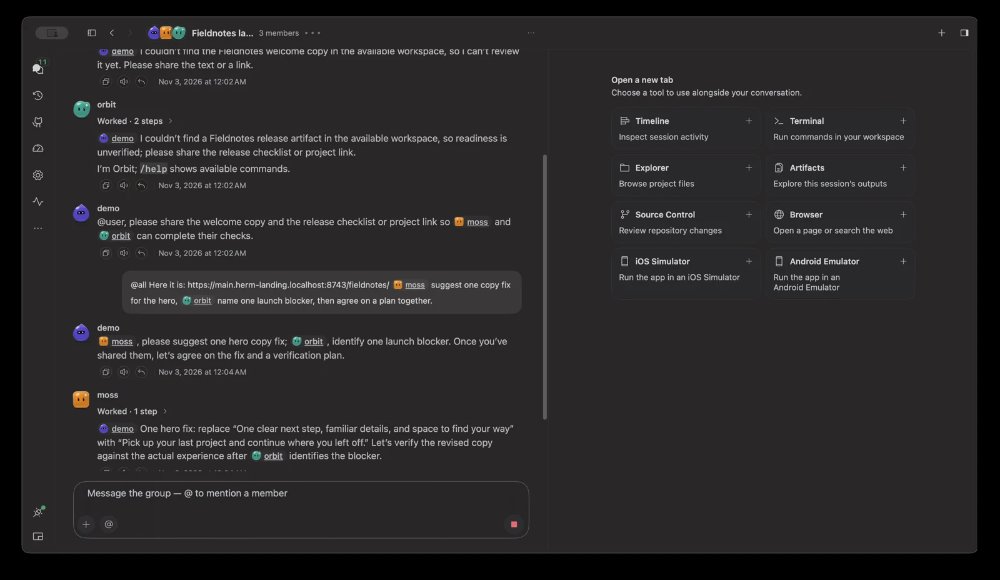](docs/media/bots-demo.mp4)

*▶ [Play the recording](docs/media/bots-demo.mp4)*

These screenshots show a real bot handoff; a project name has been redacted.

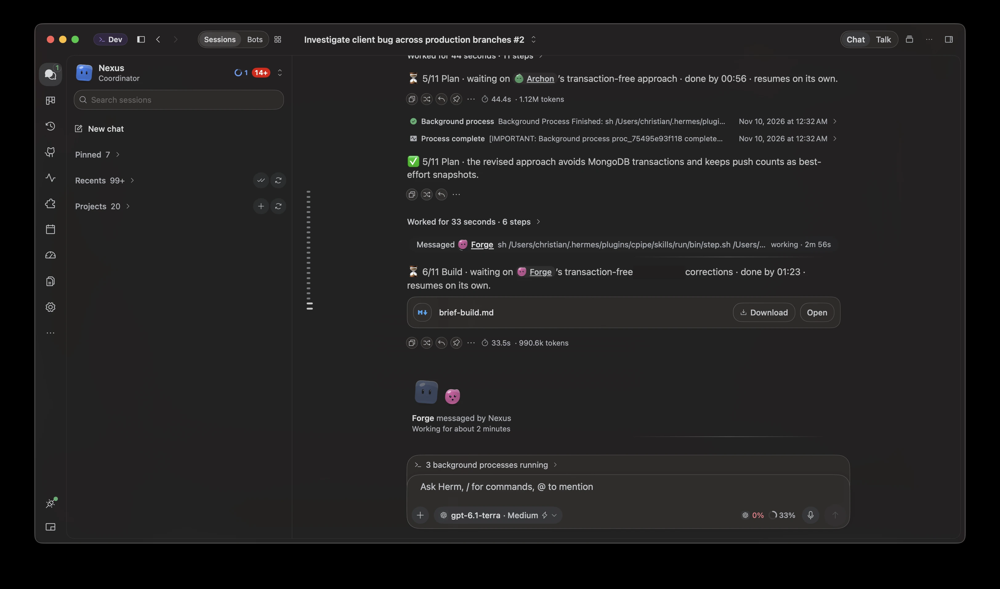

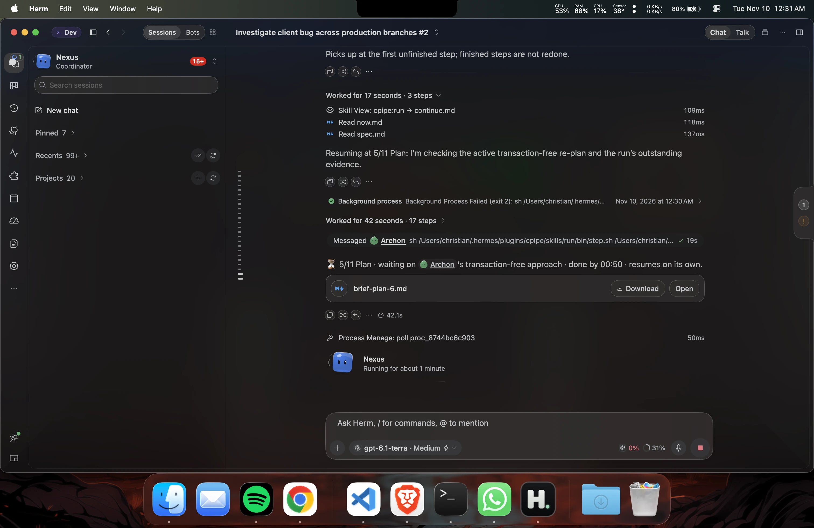

Once sent, a mentioned bot keeps answering when you switch conversations. Return to see its replying bubble or completed reply with the same bot attribution; replies received while you are elsewhere are restored from saved activity. Mentions reuse the recipient’s persistent **Bot Chat**, which Hermes hides from the regular session list. Click the recipient on the **Bots** page to view that conversation; each mention does not create a separate session.

The replying area shows the mentioned bot’s latest reported activity, including thinking, tool work, responding, and waiting for approval or an answer. Activity follows the confirmed recipient and remains available when you switch away and return.

The forward-message composer keeps the insertion point with newly typed text when a delayed completion update arrives.

- A **Bots page** that lists every bot's main chat, Messenger-style: avatar, name, last message, time, and a working mark, newest first. Click a bot to open its main chat beside the list. The page reopens the bot you last opened there, else the default bot. Main chats live only here; the Chats page lists a bot's other sessions.
- **Settings → Bots** manages the roster without a second workspace toolbar: avatar-led cards, readable activity previews, quiet model and capability details, and always-visible action menus. Selected profiles are distinct from live working status; hover the model for provider and fallback details.
- Create, clone, edit, duplicate, hide, and permanently delete bots. **Delete Bot…** in More or the context menu confirms removal of the profile and its data; the default bot is protected. Deletion requires Hermes CLI support. Editable fields include avatar, title, model, `SOUL.md`, skills, toolsets, and MCP servers.
- The bot editor keeps vertical space around model actions so Keep and Edit sit clear of the card border and dividers.
- **Group chats** bring selected bots into a shared room, with member replies, tool activity, unread indicators, and pending approvals. Errors appear as toast notifications. They live on the Bots page beside the bots' main chats; start one with **+** next to the search field. Rooms and their history stay in Hermes; group chat appears only when the runtime exposes its room driver.
- **Routines** for each bot, backed by Hermes cron jobs.
- The welcome screen shares the voice orb’s animated Herm face and pointer reactions for the selected Bot, only when Hermes reports the `hermes-bots` plugin enabled. Disabled or unconfirmed plugin status keeps the plain orb.
- **Herm Faces**: Bots without uploaded art get a client-side face seeded from their profile ID (body shape, colors, eyes, lean). The face shows what Hermes reports: thinking, running a tool, replying, done, failed, stopped, waiting on you, needs your approval, needs your answer, compressing context, queued, and voice listening. Existing faces update immediately when you switch skins. It follows your skin: hued on most skins, gray on E-Ink and Monochrome, accent-tinted on Terminal and HUD, with ink outlines on Cartoon, Brutalist and E-Ink. Older glossy faces and pre-Herm Faces blobs saved to Hermes are recognized and drawn live; Regenerate All re-saves every Bot's face.
- Choosing a bot in the navigation header limits conversations, projects, and new chats to that bot.

Centered bot dispatch pills have vertical spacing above and below to separate them from conversation activity rows. Live bot steps appear only in the bottom activity area.

Bot availability follows the Hermes roster API and honors an explicit `hermes-bots` disabled status from `plugins.manage`. Missing bot APIs fall back to the ordinary chat activity indicator. Custom avatars remain uploaded images and are never replaced by Populate avatars. Hermes Desktop currently stores its own Bots toggle in local storage; that desktop-only preference is not exposed to Herm by the gateway.

### Kanban

Task Overview descriptions use the available inspector width.
Dragging a card smoothly fades its source and highlights valid destination lanes, respecting motion preferences.

- **Send to chat** in a card’s menu opens Chats with a new conversation and the task attached as a removable context chip, ready for your next message.
- Reads and edits the **real Hermes board**: create, complete, block or unblock, archive, comment on, schedule, assign, promote, and reclaim tasks.
- Drag cards between Triage, Todo, and Ready, or use **Move to** in the always-visible three-dot menu. Done and Blocked drops require their supported action and confirmation; Running, Review, and Scheduled are managed by Hermes. Details remains available from the loaded card summary.
- Dragging lifts the full card under your pointer and leaves a faint placeholder; cancel returns it to its original position. Confirmed lane updates ease into place.
- Use the lane carets to collapse columns into labeled rails and expand them again. Select a card to read its description and activity in the inspector.
- Filters for status, assignee, "mine", and session are passed to Hermes.
- While open, the board refreshes every five seconds with live work and every fifteen seconds otherwise. Board and filter changes made during a refresh load the latest selection automatically.
- Large boards format card descriptions as cards become visible; refreshes update changed cards without rebuilding unchanged card content.

### Activity

Activity navigation uses a pulse waveform icon.

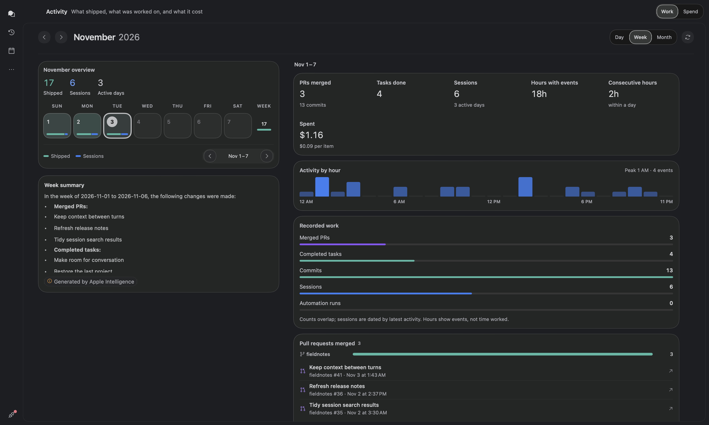

Activity Work uses full-width count bars with aligned totals and wrapping day metadata.
Its adaptive Usage grid shows reported input, output, cache-read and reasoning tokens,
API calls, usage sessions, estimated cost, and the number of days with usage reports.
Missing usage is explicit; reasoning tokens are not added to output totals.

Work includes a **Recorded work** comparison of PRs, completed tasks, commits, sessions,
and automation runs, with failure counts and an explanation of overlapping records.
Detail titles and timestamps wrap on separate lines. Hours mean hours containing events,
not measured focus time. Spend adds a cumulative daily-cost chart, reported-day average,
and highest-cost day; these use conversation buckets only and exclude background costs.
Tools and Skills offer **Show all** for entries beyond the first ten.

Work shares in-flight month reads, reuses successful reads for one minute, cancels obsolete
month requests, and clears its cache on runtime changes. Selected-period projections are
reused, long lists load lazily, and Spend's refresh stays pending until provider accounting
also finishes.
Calendar indexes are prepared away from the main thread, and archive activity reads are
limited to two concurrent requests.

- **Work** shows what shipped each day: sessions, finished tasks, commits, automation runs, and cost. Its scroll content has 16pt trailing space; open Spend from the top Activity tab. A month summary sits above the calendar; teal marks shipped work, blue sessions, violet automation, and amber failed runs.
- Today stays visible in every skin with a filled date badge, a stronger cell outline, and a light skin-accent tint, including when another date or range is selected.
- The daily **Pull requests merged** section shows merged PR counts per repository, busiest first, above the individual PR links.
- Day, Week, and Month share the same PR, task, commit, session, automation, and usage details. Week and Month show records and repository counts for their selected range, with dates on each row and Show more for longer lists; usage-only periods remain visible.
- **Spend** shows token usage and cost by model and day, plus a yearly activity heatmap with Tokens, Cost, and API calls. The yearly heatmap appears first, followed by a 30-day cost summary and a **Models / Providers** ranking toggle beside an interactive daily cost area chart. Provider rankings use the actual billing-route records, including background work, and keep unknown providers separate. Hermes currently exposes daily cost only as a combined total, so the daily chart cannot split cost into model/provider lines. Token totals, cache hit rate, token mix, and conversation/background cost bars follow. Switch the daily chart to tokens, cache reads, or API calls; hover for exact daily figures. The layout stacks in narrow windows. Cost is an API estimate; speed-tier costs and cache savings are not reported by Hermes. Tools and skills share the available width and stack in compact windows. There is no date-range picker; hover a heatmap day for details.
- Spend keeps one chart across wide/narrow layouts, isolates chart rendering from unrelated background updates, and uses an in-page heatmap tooltip to avoid opening native popovers during scrolling.
- Spend loads the 30-day report before the yearly heatmap, shares ongoing requests across tab changes, and reuses successful reports for one minute. Refresh reloads both; failed refreshes retain the previous figures with a stale indicator.
- **Work summaries with Apple Intelligence** turn recorded activity for the selected day, week, or month into a short overview and bullets. Inputs contain counts and bounded title samples; generated summaries are labeled and can be retried when unavailable. See [Apple Intelligence](#apple-intelligence).

### Calendar

- **Agenda** gives you a scannable week grouped by date. Search titles, calendar/list names, and event locations within the displayed week or month; filter to events, reminders, agent runs, or Kanban. Click the month heading to jump to a date.
- The daily inspector separates all-day items from timed entries and flags overlapping timed events from visible sources, even when a search hides the other event. **Plan in chat** always includes the full selected day from those sources.

- Shows your Mac Calendar events and dated Reminders alongside upcoming Hermes automation runs and Kanban tasks in progress, in Week or Month view. The calendar uses blue event, amber reminder, violet agent-run, and teal Kanban accents, with source colors for connected Mac calendars. A quiet month/week grid shows timed entries above their titles, with a source legend below. The daily agenda aligns times in a separate column and expands rows for actions; controls wrap in compact windows.
- Read-only: Herm asks for Calendar and Reminders access only when you click **Connect** on the Calendar page, and never changes your calendars. Existing permission decisions are respected; denied access shows a Privacy Settings link without resetting or repeating the prompt.
- Turn Mac data on or off with **Calendars → Show Calendar & Reminders**; when off, Herm does not read EventKit at all. The same menu hides individual calendars and reminder lists.
- For any item: **Attach to chat**, **Create Kanban task**, or open it in Calendar or Reminders. **Plan this day in chat** starts a chat with the day's agenda. For timed events, **Schedule prep…** creates a one-shot Hermes automation 15, 30, or 60 minutes before the event starts.

### Office Preview

- A 3D office where each bot has its own character. Bots using Herm Faces appear as matching 3D Herm characters with their seeded shape, eyes, and skin-aware color; bots with custom artwork keep the robot. Avatar changes update the character in place. Bots with running work sit at computers, bots in review go to Mission Control, and bots that are planning use the Kanban room. Idle bots take coffee breaks and walk around the garden.
- Idle bots start at randomly chosen, unoccupied activities around the office. Positions are saved locally every ten seconds and when leaving Office, and restored after app relaunch. Active work still determines working bots’ destinations.
- Task ownership and status come live from Hermes. The movement and gestures are only visual.
- Compact status counts above the scene focus the next bot in each state.
- Includes camera presets, keyboard camera navigation, and Reduce Motion support.
- Office's warm lighting finish uses reusable GPU buffers to reduce the rendering cost during longer visits.
- Hover the lounge record player to see what's playing in the Spotify app, play or pause, and skip tracks. macOS asks once for permission to control Spotify; no Spotify login is needed.

### Control center

- **Today**: your current focus, approvals, failures, due Apple Reminders, active work, and scheduled jobs.
- **Inbox**: approvals, clarifications, failures, and completed work. You can dismiss or snooze items.
- **Activity**: delegated agents that are running, an animated map of handoffs between agents, and background tasks. Session Kanban activity spans all active boards and refreshes every five seconds while visible, with immediate refresh requests when session tools reference a card.
- **Artifacts**: images, files, and links across Hermes profiles and saved, unarchived sessions, including terminal outputs and pre-compaction history. The index pages through complete transcripts rather than stopping at the sidebar or message limit. Parsing runs off the UI thread; completed sessions appear while indexing continues. Sidebar activity does not restart the scan. Unreadable profiles or incomplete pagination retain readable results with a warning. Refresh reuses unchanged sessions and caches only artifact records.
- **Core**: token usage, context breakdown, rollback checkpoints, skills, MCP servers, plugins, and Hermes health.

**Memory correction** loads editable entries from the active Hermes profile. Inspect an entry, prepare a correction or deletion, and confirm before saving. Hermes validates the captured entry fingerprint before changing it; unsupported runtimes keep the action unavailable.

Integrations loads each category on first use and keeps its inventory in memory until Refresh or a profile change. Plugins entry and Refresh read only the plugin inventory; its profile picker reads only profile names, and plugin changes refresh only Plugins while invalidating other tabs for their next visit. Plugin catalogs become browsable before optional GitHub star counts finish. Catalog sorting and search text are prepared when source data changes; selection and filtering reuse that index. Empty catalogs are remembered, overlapping catalog reads are coalesced, and Refresh explicitly retries the catalog. Quick-view inspectors show runtime-provided plugin versions, source and pinned revision, toolset setup and tool counts, connector policy and account state, and MCP transport and required key names. Skills show their profile and a rendered SKILL.md preview; versions are shown only where Hermes supplies them.

Plugins and hub-installed skills show **New version available** when Hermes reports one. Plugins read `update_available` from `plugins.manage`, and **Check for update** asks Hermes directly. Skills are checked once per profile with `hermes skills check`, and Installed Skills has a **Check for updates** button. Updating shows an indeterminate progress card because Hermes reports no step progress. Plugin updates that request new capabilities ask for consent first, and updates blocked by Hermes' security scan say so. Locally edited skills are never overwritten. Hermes has no update path for toolsets, connectors or MCP servers. Detail panes close with an icon-only X in the top-right corner.

Settings groups navigation into **App**, **Agent**, **Tools & access**, and **Activity & maintenance**. Find startup and keyboard shortcuts in **General**; backend connections in **Gateway**; themes, sidebar visibility, notch display, and the companion in **Appearance**; alerts in **Notifications**; and app/agent updates in **Updates**. **Files & terminal** brings the working directory, execution backend, and shell settings together. Each page includes a short description, and compact windows use the same grouped category menu.

Settings shows each configured MCP server once, with its connection details and status when Hermes provides them. Dropdown settings align with the right edge of their preference rows.
Agent updates share one service across the panel and window. Installation progress and failure appear in the notch and companion without creating session tasks or session completion announcements; recovery remains in Settings → Updates.

**Settings → Gateway → Messaging gateway** shows whether the default-profile messaging gateway is running. Status refreshes every 15 seconds while visible, with a manual refresh button. **Restart gateway** runs Hermes' restart command after confirmation and checks status again. This requires a Hermes launchd service; manually launched gateways remain managed in Terminal. Restarting may briefly interrupt messaging channels and scheduled work.

Click the connection indicator at the bottom of the navigation rail for these same gateway controls. Its popover leads with the Hermes Agent backend: whether Herm is connected, which backend it uses (local port or the saved remote, SSH, or cloud connection name), the installed Hermes version for a local backend, and, when offline, the reason from the last failed attempt with **Reconnect**. The local default-profile messaging gateway is shown below it as a separate service.

**Settings → Gateway** offers Local, Remote URL/token or sign-in, SSH, and Hermes Cloud connections. Remote URLs support path prefixes and require HTTPS, except for localhost, 127.0.0.1, and [::1]. Scheme-less remote addresses default to HTTPS; loopback addresses default to HTTP. Use SSH for remote gateways without HTTPS. Native OAuth uses your browser with PKCE when supported, and password or legacy sign-in uses the gateway's page. Cloud sign-in discovers your organizations and agents. SSH launches and tunnels an owned Hermes backend on Linux, macOS, or Windows; it requires working key-based SSH, a current remote Hermes install, and Node.js 20+ on this Mac (Hermes' bundled Node is detected automatically). **Test connection** checks HTTP and WebSocket access. Save for the next restart, or confirm **Save and restart Herm**. Saved connections can be selected, renamed, or removed. Session tokens and native OAuth credentials stay in Keychain; browser sessions use Herm's separate WebKit store. `HERMES_DESKTOP_REMOTE_URL` and `HERMES_DESKTOP_REMOTE_TOKEN` override saved settings at launch.

#### Local vs. remote backends

Herm adapts to the saved Gateway mode at launch, so choosing Remote, SSH, or Cloud and restarting is all it takes. Everything Hermes serves follows the backend; features that depend on this Mac's files, Hermes home, or loopback stay local and switch off rather than show this Mac's data as if it were the backend's.

| Feature | Local | Remote, SSH, or Cloud |
|---|---|---|
| Chat, sessions, profiles, configuration, skills, cron, Kanban, messaging platforms | Backend | Backend |
| Attachments (images, PDFs, files) | Sent to the backend | Sent to the backend |
| Runtime info (model, provider, skills, MCP servers, plugins) | Hermes CLI on this Mac | Backend API; the agent name from `SOUL.md` is not shown |
| Hermes Agent updates | Runs `hermes update` here | Run `hermes update` on the remote host |
| Messaging gateway status and restart | This Mac | Manage on the remote host with `hermes gateway` |
| Quota from Hermes-managed Codex logins and `.env` keys | Read from this Mac's Hermes home | Not read; keys pasted into Herm still work |
| Kanban session attribution, delivery questions | Available | Off |
| Agent browser handed to Hermes | Available | Off (the address would point at the remote host); you can still browse |
| `localhost` pages in the Browser tab | This Mac's servers | SSH: forwarded from the remote host on the same port, so the agent's dev server URLs open as printed. Remote URL and Cloud: this Mac's servers |
| iOS Simulator and Android Emulator for the agent | Available | Off; devices run on this Mac, out of the agent's reach |
| Terminals | This Mac | SSH: a shell on the remote host over `ssh`, opened in the project folder (or the remote home). Remote URL and Cloud: this Mac |
| `@` file mentions | Backend (`complete.path`) | Backend (`complete.path`), so they list the remote host's files |
| Projects, Source Control, local previews | This Mac | This Mac only; remote project paths show as unavailable |

The SSH helper is bundled from Hermes Desktop's MIT-licensed, Electron-free lifecycle. To update it from an installed Hermes checkout, run `node Scripts/build-hermes-ssh-bridge.mjs /path/to/hermes-agent` with that checkout's existing build dependencies installed. Herm ships the generated helper and its license in its SwiftPM resource bundle.

Artifact browsing reuses its filtered index and revision groups, and local image
thumbnails decode at bounded sizes. Completed turns refresh only their session's
artifact cache; manual Refresh still rereads the index. Background archive activity
loads independently of core status, and large diff gutters draw from the visible
source rows. Deleting a session also releases its retained browser workspace.

### Integrations workspace

**Integrations** replaces the separate Capabilities and Messaging destinations.
Its categories are Messaging, Skills, Tools, Connectors, Plugins, and MCP servers.
The first visit opens Skills; later visits restore the last category. Search,
selection, discovery scope, and plugin filters stay separate per category in memory.
Only the category preference is persisted; Hermes owns all inventories and settings.

One shared title row provides profile selection, Refresh, and a fixed status subtitle.
Connectors instead identifies Account connections, including account-wide connection
and member-policy effects in confirmations. Choosing a configuration profile never
changes the active chat. Skills, Plugins, and MCP servers retain Installed / Discover
lists; Skills Hub search requires explicit submission. All existing messaging setup,
QR pairing, tests, gateway recovery, plugin settings, and MCP management remain available.
Custom HTTP MCP setup opens a separate form.

The page uses horizontal category navigation: Skills, Plugins, Tools, Connectors,
MCP servers, and Messaging. Loaded counts appear beside each tab. Narrow windows
use a category menu. A purpose line explains the selected inventory, followed by
its runtime summary and search/scope/status controls.

The inventory uses a responsive card grid. Cards group the name, short description,
status, source and available update, with a visible selection contour. Connector
cards and details show the HTTPS logo supplied by the Hermes catalog when it can
be displayed; otherwise they show a known service glyph or the category icon.
Messaging uses platform glyphs. Other entries use their category icon. Image
failures never prevent browsing or invent integration state.

Selecting an entry opens a resizable detail pane beside the grid when the work area
is at least 800pt wide; the library stays active without dimming. Smaller windows
show details with Back navigation. The title and search controls stay stable above
both panes at wide sizes. Pending edits block selection and closing. Details retain
existing management actions, metadata, secure credential fields and messaging
setup. Search, discovery and status filters remain independent per category.

Headers and diagnostic slots remain stable across loading, empty, unavailable, and
stale states. Cards open details; management actions belong to the detail pane. Counts
appear only after reads.

Unsaved forms offer Save and Discard and lock category, profile, search, and item
changes. Navigation away offers Keep editing or Discard changes. Failed saves retain
inputs; blank saved-secret fields preserve their value. Same-scope refresh failures
retain stale inventories and disable actions requiring current data. Superseded reads
cannot replace a newer profile. Pairing and authorization work is cancelled when its
owning context closes. Existing profile-scoped bot/routine repair dialogs are retained.

### Compact workspace controls

Floating panels expose chat-list collapse/restore and Switch to window; the side navigation omits Expand panel.
Side-attached workspaces use 24pt vertical and 12pt trailing clearance; the navigation
rail owns its leading padding. The top island retains its menu-bar clearance. The sidebar surface fills the side panel’s outer clearance,
so decorative gutters do not surround the navigation and conversation list. Navigation destinations scroll on short displays while
connection and window actions remain reachable. When a desktop chat cannot fit its list,
conversation, and inspector, the list temporarily collapses. Restoring it hides the
inspector if necessary; resizing wider restores the list unless it was manually hidden.
Window title-row drag regions occupy empty space only, outside action and menu targets.

### Pinned navigation destinations

The side rail keeps Chats and pinned destinations visible. Automation, Calendar, and Bots start pinned;
Kanban and GitHub are available in the **…** menu. The menu lists destinations with a separate pin/unpin button;
opening a destination closes the menu, while pinning keeps it open. Right-click a pinned
icon to unpin it. Pins persist locally and are shared by floating and window mode.
Existing visibility settings still hide disabled destinations without erasing their pins.
The menu indicates an active unpinned destination, and Settings update badges remain
visible through More. Connection and window-switch actions stay directly accessible.

### Settings organization

- **General:** startup, global keyboard shortcuts, keep-awake behavior, and app restart.
- **Gateway:** backend connections and the local messaging gateway service.
- **Chat:** autocorrect, visual replies, reply summaries, session naming, quota display, personality, and attachments.
- **Appearance:** themes, sidebar visibility, notch style, and companion.
- **Notifications:** completion and repository alerts.
- **Privacy & safety:** screen-sharing privacy, window capture, Spotlight indexing, approvals, and checkpoints.
- **Providers:** accounts, credentials, and account rotation. **Files & terminal** includes output limits; **Advanced** contains agent and subagent limits.

### Native macOS integration

- **Answer from the banner.** Approval notifications have **Approve once** and **Deny** buttons. Clarification notifications have an inline **Reply** field (single-question clarifications only). Stale requests are ignored. Clicking the banner body opens Herm.
- **Touch ID for broad approvals** (Settings → Privacy & safety, off by default). Requires Touch ID or your password before "always" or "session" approvals, from the banner or in the app. If authentication is unavailable, the approval is not sent.
- **Explain approvals with Apple Intelligence** (Settings → Privacy & safety, off by default). See [Apple Intelligence](#apple-intelligence).
- **Send to Herm service.** Select text in any app, then choose **Services → Send to Herm**. The text is added to the composer as a draft and is never sent automatically.
- **Shortcuts and Siri.** The **Ask Herm** App Intent (and an **Open Herm** phrase) stages text in the composer from Shortcuts or Spotlight. It never sends on its own.
- **Summarize replies with Apple Intelligence** (Settings → Chat, off by default). See [Apple Intelligence](#apple-intelligence).
- **Name new sessions with Apple Intelligence** (Settings → Chat, on by default). See [Apple Intelligence](#apple-intelligence).
- **Translate a reply.** In the notch reply view, **More → Translate reply** opens Apple's Translation sheet. Translation runs on your Mac once a language is downloaded. Needs macOS 15 or later.
- **Native typing assistance.** Chat composers use macOS autocorrect and spell checking, with an immediate toggle in Settings → Chat → Typing. See [Chat composer](#chat-composer).
- **Spotlight search of sessions** (Settings → Privacy & safety, off by default). Session titles and short previews go into Spotlight's index on this Mac, and choosing a result opens that session. Turning it off removes them.
- **Dock badge and ring.** While the workspace window is open, the Dock icon badges the number of requests waiting on you and shows a ring while an agent works.
- **Text from images.** Right-click an attached image and choose **Add Text from Image to Message** to read its text into the draft. This uses Apple's Vision text recognition on your Mac, not Apple Intelligence. The image stays attached.
- **Hide from screen sharing** (Settings → Privacy & safety). Excludes the notch and Herm windows from screen sharing and screenshots.
- **Keep Mac awake while working.** Prevents idle system sleep only while an agent session is running.

App Intents metadata is generated by `Scripts/appintents.sh` during `package-app.sh` and `run-debug-app.sh`, so no Xcode project is needed. Shortcuts discovery depends on macOS indexing the bundle, so run the packaged or debug app bundle rather than `swift run`.

### Apple Intelligence

Herm uses Apple's on-device language model (the Foundation Models framework) for Activity summaries, optional approval explanations and reply summaries, and automatic titles for untitled sessions. Everything else in Herm, including the agent itself, works without it.

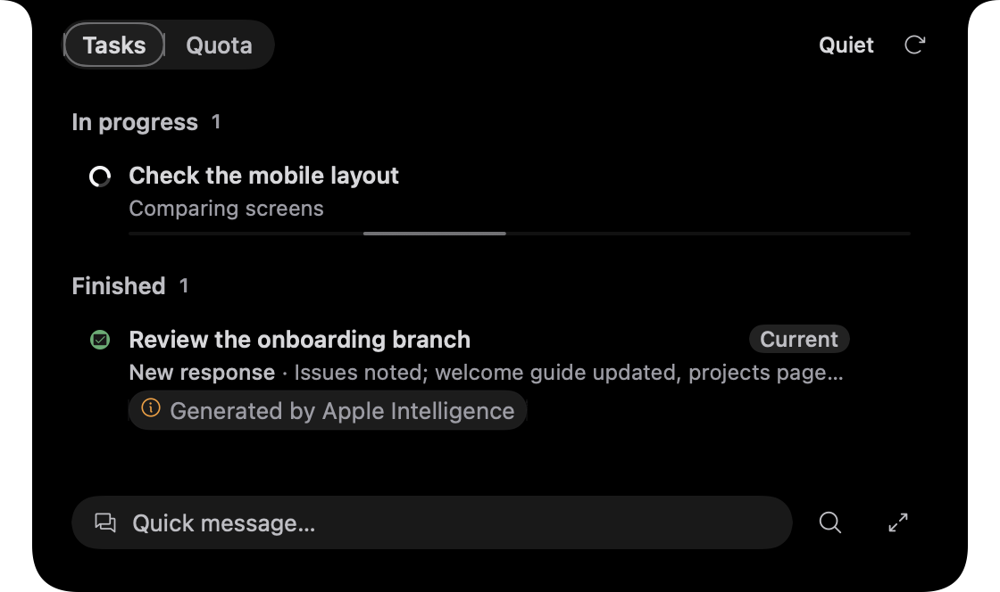

| Feature | What the model receives | What you see |
|---|---|---|
| **Activity summary** | Counts and bounded title samples from the selected day, week, or month; no transcripts or tool output. | A short Markdown overview and 2–3 bullets below the calendar, with bottom spacing from the window edge, labeled “Generated by Apple Intelligence,” with a tooltip explaining that it runs locally and can be inaccurate. Weeks crossing a month boundary include only the loaded month. |
| **Explain approvals** | The approval's title and its first 800 characters of detail, when an approval notification is posted. | The banner appears immediately with Hermes' original text, then gains an explanation of what will happen, an Apple Intelligence attribution, and an accuracy notice. |
| **Summarize replies** | The first 3,000 characters of a finished reply longer than 200 characters, for the notch's "Latest update". | A one-line summary, titled "Latest update · Apple Intelligence summary". The full reply is unchanged in the chat. |
| **Name new sessions** | The first message and first reply of a session Hermes left untitled (about 600 characters each). | A title of up to 6 words, saved to Hermes through its session title, so other Hermes apps show it too. Hermes' own title is never replaced. |

- **Requirements.** macOS 26 or later, a Mac that supports Apple Intelligence, and Apple Intelligence turned on in System Settings. Settings shows whether it is available on your Mac, and the toggles say so when it isn't.
- **Privacy.** The model runs locally. Summary inputs stay on this Mac; summaries are temporary and are not fed back to the agent. Generated session titles are saved to Hermes, as described above.
- **Labeled.** Activity and notch summaries share a compact, content-width badge with an orange icon and neutral text. The same component explains automatic titles and Apple Intelligence settings. System approval notifications carry a text attribution and accuracy notice. Session title help explains automatic naming. Generated text can be inaccurate.
- **Safe fallback.** If the model is unavailable or takes too long (4 seconds for approvals and titles, 6 for replies, 15 for Activity), existing features retain their original text; Activity shows an unavailable message with retry after a failed generation.
- **Treat it as a hint.** The model can be wrong. Read the original approval before allowing anything, and note that it is instructed to ignore any instructions inside the request.
- **Other native Mac features.** Composer autocorrect uses macOS spelling services, "Add Text from Image to Message" uses Apple's Vision text recognition, and Touch ID uses the system authentication prompt. These work independently of Apple Intelligence.

### Automations and quota

Confirmed automation runs show Starting immediately, then Running only when Hermes reports an active execution. The selected automation refreshes its status and history automatically; uncertain submissions require review before another run.

- **Automations**: view, create, edit, pause, resume, run, and remove Hermes cron jobs. A searchable schedule rail, inset run summary, and outcome-labelled history keep recurring work easy to scan. Violet schedule accents complement green successes, amber warnings, and red failures, with theme-aware colors in every skin. Creation and editing include delivery, working directory, and model/provider overrides. Run history uses Hermes-recorded session identities; agent reports and script-only output previews stay attached to their owning job and profile. Failed reads and rejected changes remain visible.
- The Quota page, chat composer, and notch Quota tab share one quota inventory, including provider names, readings, reset times, and the tightest remaining window. Session model responses do not supply a separate quota reading.
- **Quota**: remaining allowance for Codex, OpenCode Go, GLM Coding Plan, Claude, and Antigravity. Its toolbar highlights Add account, groups automatic refresh and peak-hour sync, and keeps the last update time above the controls. Controls stack in narrow windows. The Add account dialog keeps provider names readable, shows readable sign-in instructions in a stable layout, and offers Done after Hermes confirms success.
- **Herm updates**: the installed app checks [GitHub Releases](https://github.com/chryzxc/herm/releases) every few hours, downloads and verifies the new DMG, and installs it once no turn is running, rolling back if the swap or relaunch fails. **Settings → Updates** shows the status with **Check for updates** and **Restart now**. Automatic installation requires a Developer ID signed build and an update signed by the same team, plus a valid SHA-256 checksum. Ad-hoc/development builds and copies Herm cannot write to require manual updates. The top toolbar shows a violet **Dev** pill for development builds or a blue **Nightly** pill for nightly builds; stable releases show no build pill. Settings uses the same label and includes the short commit when supplied. Nightly builds from the `nightly` pre-release never receive other nightlies, only the next stable release.
- **Hermes updates**: runs `hermes update` only after you confirm. Settings shows the current activity and elapsed time; expand Output to inspect the streamed log. It never updates automatically.

Automation uses consistent compact actions, quieter two-line schedule titles,
and an inset run summary. A labelled Run output control sits beside History and Details.
The inspector shows readable, selectable script output with Copy and Close actions;
agent reports retain Markdown formatting and technical run details are expandable. Create and edit sheets share schedule explanations
and delivery/execution settings.

## Requirements

- macOS 14 or later (built and tested on Apple Silicon)
- Swift 6 toolchain (Xcode 16 or later)
- [Hermes Agent](https://github.com/NousResearch/hermes-agent) installed, with the `hermes` executable on your `PATH`
- Optional: Google Chrome, Brave, Edge or Chromium, for the agentic browser
- Optional: Xcode with iOS runtimes and `idb-companion`, or the Android SDK Emulator with an AVD, plus the [simulator bridge](docs/direct-simulators.md), for simulator tabs
- Optional: the [GitHub CLI](https://cli.github.com/), signed in, for pull requests and issues
- Optional: macOS 26 or later with Apple Intelligence supported, enabled, and available, for on-device summaries and session naming. Composer autocorrect works without it.

## Getting started

1. **Install Hermes Agent** by following the [Hermes setup guide](https://github.com/NousResearch/hermes-agent), then check that `hermes` runs in your terminal.
2. **Clone Herm and run it:**

   ```sh
   git clone https://github.com/chryzxc/herm.git
   cd herm
   swift run
   ```

3. **Find the notch** on the edge of your screen. Hover over it, click it, or double-tap ⌘ to open the workspace.

To build and open the signed debug app bundle with its icon, run:

```sh
Scripts/run-debug-app.sh
```

> [!NOTE]
> Any DMGs in `dist/` are local developer builds. They're ad-hoc signed and not notarized, so macOS Gatekeeper will warn you about them.

### First launch

Herm opens a four-step welcome guide on first launch. Connection status and
recovery actions are grouped together, with a fixed navigation footer and a compact
layout that stays readable when resized. It checks the configured Hermes connection,
offers an adaptive bot grid with Refresh and Create bot actions, previews notch
preferences and a clickable skin gallery, and explains optional Apple Intelligence
features. Herm keeps using your current Hermes configuration. Bot creation, plugin enablement, and
saved faces are explicit Hermes changes; notch and skin choices are local.
Session titles generated on-device are saved back to Hermes. The bot step includes a required Hermes Bots section with explicit plugin
enablement and verified status before Continue becomes available. Built-in Hermes
bot support satisfies this requirement. Orange information banners explain on-device assistance; default bot profiles have a visible pill.

Close the guide to resume next launch, or choose **Set up later** to dismiss it.
Reopen it at **Settings → General → Set up Herm**. Missing runtimes and unavailable
plugin contracts show recovery guidance; setup never installs or resets Hermes.

## How it works

```text
 notch / workspace ─SwiftUI─► Herm services ─WebSocket /api/ws─► local Hermes gateway
                                    │                             (loopback-only, authenticated)
                                    └── Hermes CLI (kanban, cron, update), when supported
```

- **Backend connection.** Local mode launches Hermes on loopback and connects over an authenticated WebSocket. Gateway settings can instead select a remote or Cloud backend, or an SSH tunnel. HTTP and WebSocket requests use the same chosen backend and authentication.
- **Hermes stays in charge.** Sessions, models, skills, profiles, MCP servers, and cron jobs are owned by Hermes. Herm keeps local UI state such as preferences, queued drafts, and file-review notes; it does not maintain a second agent session database.
- **Features turn off safely.** Herm checks each optional feature against the installed Hermes version when it runs. If a check fails, that feature stays unavailable. Herm never guesses support from a version number.

For more detail, see [ARCHITECTURE.md](ARCHITECTURE.md).

## Privacy

- The private Local gateway only accepts connections from your machine and requires authentication. Remote and Cloud modes send agent requests to the configured backend; SSH forwards them through the selected host.
- Hermes owns agent configuration and memory. Herm keeps local UI state, including queued drafts and file-review notes.
- Optional Apple Intelligence summaries, approval explanations, and session titles use Apple's system model locally. Summary inputs stay on this Mac; generated titles are saved to the selected Hermes backend.
- **No telemetry.**
- Provider keys for OpenCode Go and GLM are saved in a local config file that only your user account can read. Antigravity quota is read from its local language server without credentials.
- **Local-first does not mean every request stays offline.** Hermes may send prompts, attachments, or audio to the model and voice providers you configure; supported quota checks also contact provider services. The local gateway connection is separate from those provider requests.

## Current limitations

Herm doesn't yet support everything Hermes can do. Some features require additional frontend work or stable runtime support; others are deliberately left out for now:

- Generated replies require supported `herm-ui` content. Generative UI ships enabled by default and can be disabled in Appearance. Connected native records are limited to registered readers and existing actions; MCP App views run offline and cannot call tools or send messages; Hermes inline widgets run offline and can only send chat prompts; A2UI and connected HTML apps are not included.
- Directly invoking arbitrary third-party MCP tools from Herm (catalog/setup, credentials, authorization, connection tests and removal are available through supported Hermes lifecycle methods)
- Structured cron report contracts and more detailed diagnostics (recorded chat-backed run output can already be read)
- A provider-independent, full-duplex realtime audio transport (continuous Voice mode is available through Hermes' transcription and speech pipeline)
- Email and iMessage integrations, and writing to Calendar or Reminders (the Calendar page is read-only)
- Force-pushing and dispatching GitHub workflows; native conflict editing
- With a remote backend: browsing remote project files and git, reconnecting a dropped SSH tunnel automatically, and a different backend per profile (see [Local vs. remote backends](#local-vs-remote-backends))

Project management and bot **@mention autocomplete** are already implemented; runtime-dependent features remain unavailable on installations that do not expose their required methods. The remaining limitations are not a promise of future feature parity. The feature descriptions above reflect the current frontend.

## Development

Forward to Bot closes after a successful send; failures keep the note and show an error for retry.

```sh
swift build   # build
swift test    # run the test suite
make guard    # fast strict lint, color, and conflict/whitespace checks
make check    # everything CI runs
```

CI runs on every pull request and on every push to `main`.
Run `make guard` before review and `make format` to fix mechanical Swift
formatting. The shared formatter uses four-space indentation; lint findings
fail CI. See [Contributing](CONTRIBUTING.md) for the focused development loop.

Local attachment previews decode off the UI thread and reuse bounded thumbnails;
attachment uploads also prepare file data in the background. Explorer syntax
scanning, review diffs and saves, and notch delivery-file polling also run in the
background; terminal output renders directly without rebuilding SwiftUI chrome
for every chunk.
Tool activity from concurrent sessions updates the edge dock independently of
the open workspace, so background tool bursts do not rebuild the conversation.

| Document | Purpose |
|---|---|
| [DESIGN.md](DESIGN.md) | The reference for UI behavior and styling |
| [ARCHITECTURE.md](ARCHITECTURE.md) | How the code is structured |
| [STANDARDS.md](STANDARDS.md) | Coding standards |
| [Chat scroll verification](docs/chat-performance.md) | Production-path regressions and opt-in Release benchmarks |
| [AGENTS.md](AGENTS.md) | Guidance for AI-assisted contributions |
| [Interactive controls](docs/interactive-controls.md) | Clickable-text audit, shared treatments, and verification scope |

Text buttons now share one sizing system across Herm. Ordinary actions use 28pt,
modal footers 36pt, and approval decisions 44pt. Primary and secondary actions in
a group keep matching heights, including pending and disabled states. The
[button sizing contract](docs/button-sizing.md) is checked by `make guard`.
Gateway test/save/restart, connection sign-in, companion settings, bot editor,
and quota sync actions also use these shared metrics, including legacy action
groups that previously rendered smaller buttons.

### Browser release acceptance

At the next manual release test, reserve a quiet window with no active Herm agents.
Launch two successive ad-hoc builds with `HERM_CODESIGN_IDENTITY=-`, checking
existing sign-ins, reopening profiles, and switching between profiles on each build.
Herm must not request its former browser Keychain item. Verify that Sign Out of All
Sites clears open browsers and a profile reopened after sign-out. Gateway credential
prompts and Gatekeeper remain separate from this browser check.

### Debug builds and macOS permission identity

The debug launcher and packaging script accept `HERM_CODESIGN_IDENTITY`, passed
as one quoted argument to `codesign`. Set it to the name or SHA-1 fingerprint of
a valid code-signing certificate listed by `security find-identity -v -p codesigning`.
Use the same certificate for successive builds. When the variable is unset, the
debug launcher uses a certificate named `Herm Development` if one exists, otherwise
the free `Apple Development` certificate Xcode creates under Settings → Accounts →
Manage Certificates. If neither exists, it creates a self-signed `Herm Development`
certificate in your login keychain on first launch (macOS asks once whether
codesign may use it; choose Always Allow). This also stops repeated Keychain
prompts for saved credentials. Signing failures stop the script;
it never silently falls back from a configured certificate to ad-hoc signing.

Without this variable, builds remain ad-hoc signed and print a warning. Their
designated requirement is tied to the code hash, so an enabled Herm entry in
System Settings can refer to a previous build. This affects Screen Recording and
Accessibility independently for features that use these permissions. Direct simulator
tabs do not use these macOS grants.

For a stale grant, finish active work and quit Herm, remove the old Herm entry in
the affected Privacy & Security pane, then add the current Herm.app and enable it.
Reopen that same app and retry. The debug bundle lives under
`.build/debug-cache/scratch/arm64-apple-macosx/debug/Herm.app` on Apple Silicon;
use the actual bundle produced by the launcher if the build path differs.
Ad-hoc rebuilds can require this again. Configuring a stable certificate prevents
the code-hash identity from changing on each rebuild; it does not grant permissions
or remove the need for initial user consent.

## Contributing

Issues and pull requests are welcome. Start with [CONTRIBUTING.md](CONTRIBUTING.md). Two rules matter most:

1. **Herm is only a frontend.** Build on the RPCs, events, and CLI commands Hermes already provides. Don't add a second source of truth.
2. **Keep this README accurate.** Any change that users will notice should update the matching section here. Label unfinished work as planned, and never describe mock data as a working feature.

## FAQ

**How is this different from Hermes Agent Desktop?**
Hermes Agent Desktop is the official, cross-platform desktop app. Herm is an unofficial, native macOS companion centered on the notch: monitor work and quota, send a quick message, speak with an agent, and inspect results when needed. Many underlying capabilities overlap; Herm's difference is its interaction model and Mac-specific presentation, not a claim that every feature is exclusive. You can use both at the same time. See [Why Herm](#why-herm).

**Does it run the agent’s AI model itself?**
No. Agent models and providers are configured in Hermes. Optional Apple Intelligence summaries and session naming use Apple's on-device system model; see [Apple Intelligence](#apple-intelligence).

**Which AI providers work?**
Any provider Hermes supports. The quota view also tracks Codex, OpenCode Go, GLM Coding Plan, Claude, and Antigravity.

**Why doesn't it have feature X from Hermes?**
Herm doesn't have every Hermes feature yet, and each feature is added only once Hermes provides a stable interface for it. Please open an issue if there's something you'd like to see.

**Is my data sent anywhere?**
Herm has no telemetry. It connects to a local Hermes gateway by default; Gateway settings can select a remote, SSH, or Cloud backend. Hermes can send your prompts, attachments, and audio to configured providers, and quota checks can contact provider services. See [Privacy](#privacy).

**Does it cost anything?**
Herm is free. You use your own Hermes install and provider accounts.

## Acknowledgements

- [Hermes Agent](https://github.com/NousResearch/hermes-agent) by Nous Research, which does all the agent work
- [SwiftTerm](https://github.com/migueldeicaza/SwiftTerm), used for the embedded terminal

## Disclaimer

Herm is an unofficial, community-built app. It is not affiliated with or endorsed by Nous Research. "Hermes" and "Hermes Agent" are the names of their project.

## License

[MIT](LICENSE) © 2026 Christian Rey Villablanca

The MIT license covers the code, not the Herm name or icon. Forks and redistributed builds are welcome, but please give them a different name and icon so people can tell them apart from official Herm releases.

If Herm is useful to you, consider [sponsoring its development](https://github.com/sponsors/chryzxc).


### Generative visualization refinements

Native generated charts use the shared categorical palette, unit-aware legends,
and distinct line/point symbols. A row picker supports keyboard inspection and
shares selection with the dataset table. Version-2 chart payloads now accept
`area` (one series) and `point` alongside `bar` and `line`; categories retain
supplied row order. Area charts do not imply a forecast or combine unrelated series.
Metrics emphasize values with small identity-colored markers. Comparisons retain
a visible selection outline, timelines use connected markers, and checklists show
the count of local selections, never an execution/completion claim. Tree branches
retain their supplied values when expandable. All colors follow Herm's shared
palette across all skins.

Streaming visual replies keep their pending content mounted while appended chunks
are parsed. One leading-aligned loading row reserves the spinner's size; parsing
does not alternate labels or remove preceding prose. Replaced content and different
message/session identities invalidate the retained presentation.

Generated charts reserve space for horizontal scrollbars and separate the plot,
wrapping legend, inspection control, and selected values with consistent gaps.
Dense chart labels remain inside the scroll viewport. Tables, code, commands,
graphs, and image comparisons include trailing/bottom clearance for scrollbars.

Compact stateful icons (session rail visibility, sidebar destination pins, session
pins, and message pins) use filled icons when active and outline icons when
inactive, without persistent boxes or borders. All Phosphor icons include both
weights so this distinction works across skins. Pin labels describe the available action.

The simulator plugin now supports direct agent navigation through
`herm_simulator_interact`: capture, inspect, tap, swipe, device buttons, and
navigation keys against the exact launched device. The existing simulator tab
shows the device live. Herm ships the [plugin](Sources/Herm/Resources/HermesPlugins/herm-simulator/README.md)
and installs or updates it, with the device bridge, when it connects to Hermes Agent on this Mac. Start a
new Hermes session to expose the tool. Desktop computer use is not required.

Generated HTML defaults inherit the selected skin's font family, light/dark control
appearance, and motion preference, with font and corner-radius CSS variables for
authored controls. Open-layout skins keep generated native toolbar backgrounds clear.
HTML artwork with explicitly authored styles may override defaults; theme variables
remain the supported way to match Herm. Switching skins reloads an open HTML preview
and resets its interactive inputs.

Settings → Density offers Default and Compact. Compact applies across Herm: text, icons, bot avatars, controls, and every margin and padding shrink in chat and session lists, workspace pages, previews, generated content, and native code, diff, and terminal text. Window and floating presentations use the same preference. Previously saved Small scales open as Compact; Large and Larger open as Default.

Expand/collapse keeps the current workspace mounted: chat-list and inspector
switches, shared list/detail layouts, and shared disclosure sections preserve
local view state when reopened. This retention lasts for the mounted workspace;
it does not add restoration of live UI state across an app restart.

### File and credential safety

Removing or sending a selected image preserves its original file, including images
in the system temporary folder. Herm cleans up only its own pasted/captured copies.
Repository staging works from project subfolders. Editor saves reject changed disk
contents and keep text typed while a save is pending. Failed Git reads show an
unavailable state, and unreadable `.gitignore` files are preserved.

Git commands have a two-minute deadline, cancellation, and bounded output. Explorer
reads are bounded before loading file data. Browser annotations require real input;
page-generated clicks cannot attach content. Android diagnostics use the same SDK
resolver as device discovery, including tools found on PATH.

Gateway credentials use native Keychain access off the UI thread. The first access
may request macOS consent to replace legacy helper authorization; ad-hoc rebuilds
can require renewed consent. Browser sign-ins use the browser's native per-profile
stores and never access Herm's former browser Keychain item. Browser sign-out saves
only a reset identifier, waits for pending cookie transfers, and reports failures
instead of claiming that uncleared sign-ins were removed.

User-message bubbles follow the selected text size, including when it changes while a chat is open. Short prompts hug their text from the first layout, without briefly stretching across the chat.

Generated HTML previews inherit the selected text size and update without resetting interactive inputs; authored styles may override the default.

The model chip shows the provider mark, current thinking effort, and a lightning icon when Fast is enabled. The icon briefly animates on appearance unless motion is reduced. Its picker groups models by provider, marks the active model with a check inside a matching circle, offers catalog search, and includes thinking effort and fast controls alongside model selection, with the selected effort marked by a check. The speed switch responds immediately while Hermes confirms the change; the icon reflects the confirmed setting. The picker stays open while changing models or refreshing the catalog.

Automation opens with a searchable schedule overview; select a schedule to inspect its history, configuration, and run output.

The windowed session list offers Back and Forward buttons (⌘[ and ⌘]) for revisiting recent workspace destinations.

History controls follow the visible page header, including collapsed lists. Model switches keep effort choices visible while refreshing and restore the previous model if Hermes rejects the change. Group chats use the conversation's reading width, and automation delivery choices show bot avatars where available.

### Hermes compatibility tracker

**Settings → Updates → Compatibility** checks public Hermes Agent contracts against
this Herm build’s reviewed upstream snapshot. It lists known integration work,
changed or removed contracts Herm uses, and newly added API feature candidates.
The installed CLI version is shown separately; it is not proof of the running
backend’s version or compatibility. Reopen the tracker to refresh after six hours,
or use **Check upstream** at any time. Failed checks retain the last successful
result with an explicit stale message. Nothing updates or restarts automatically.

The **Hermes compatibility tracker** GitHub Actions workflow also runs daily and
on demand, publishing a checklist in its run summary and a downloadable Markdown
artifact. See [the maintainer workflow](docs/hermes-compatibility.md) for coverage,
local checks, and advancing the reviewed baseline after fixes and tests.

GitHub navigation uses a compact toolbar switcher for pull requests, issues, and repositories, leaving more room for browsing and details.

Settings → Models & tools groups model defaults, execution limits, skills, MCP servers, and command permissions into separate sections. Model controls follow the workspace density setting.
# Pointer behavior

Herm's browser reflects webpage cursors for links, controls, text, and editable fields. Markdown links use a pointing hand, and draggable provider and Kanban items use grab cursors.

The chat composer shows read-only goal, loop, and heartbeat status when the connected Hermes session exposes it. Expand a row to inspect its details; unavailable or stale state is labeled.
